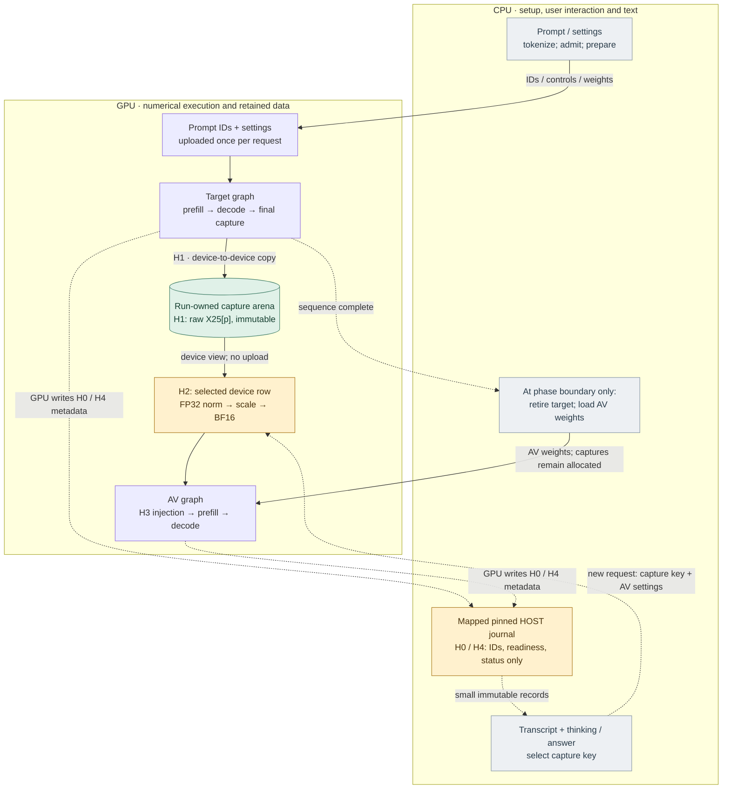
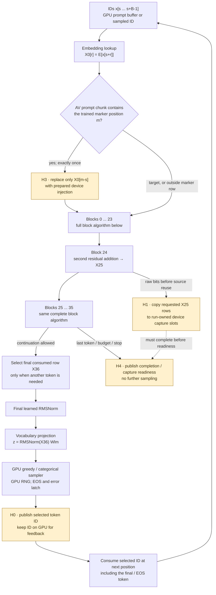
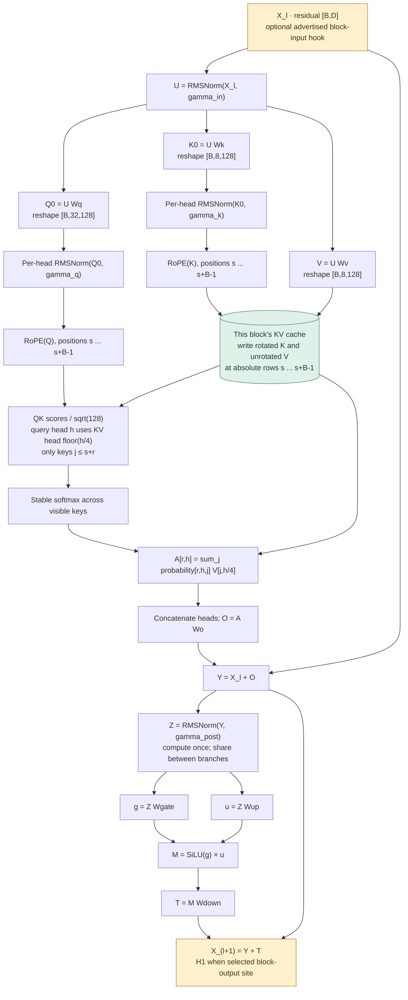
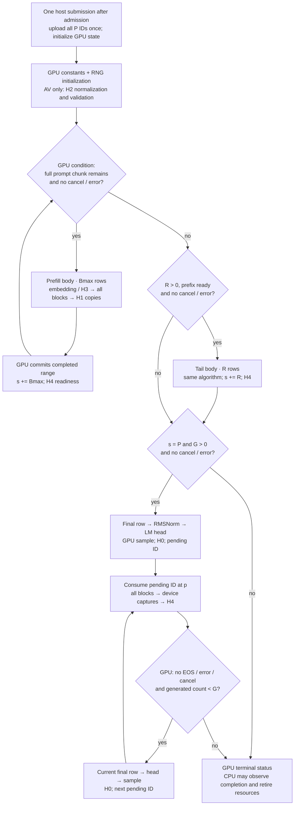
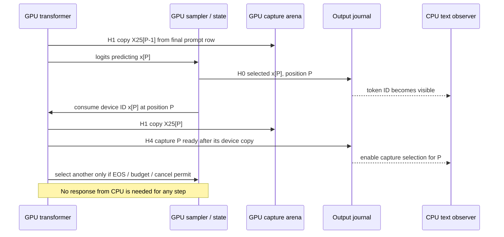
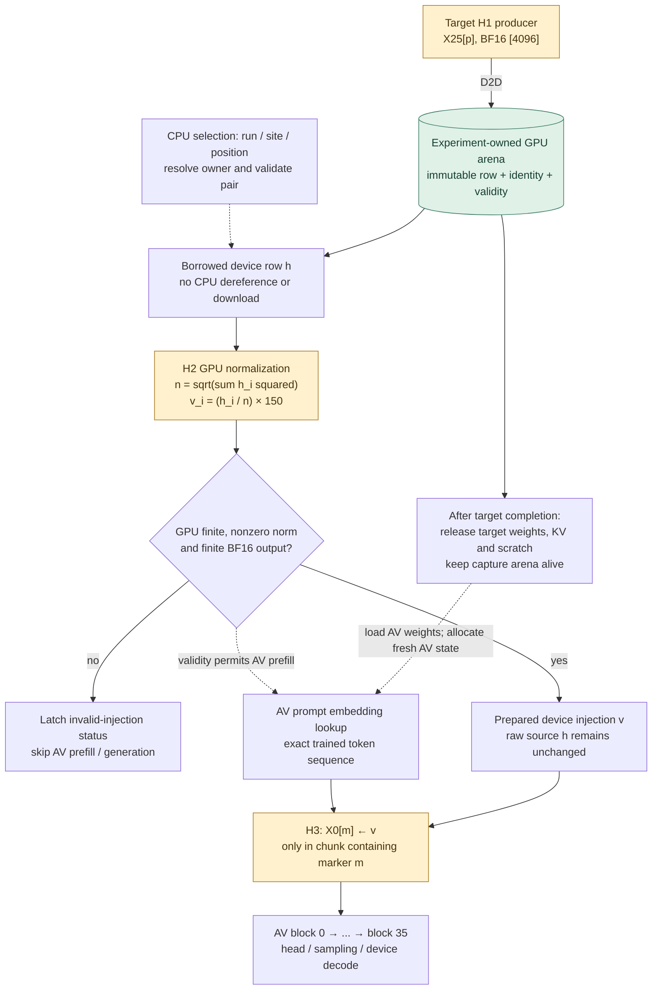
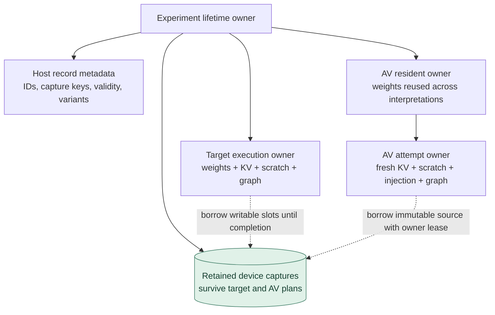

# GPU execution boundary and complete transformer flow

**Reviewed, accepted and implemented for CUDA — 2026-10-20.**

Native and forced-PTX numerical workflows, CUDA memory checks, application
integration and execution traces pass on the RTX 3090 Ti. Independent references,
precision and acceptance limits are unchanged. Metal and reconstruction remain
future work; this evidence does not establish compatibility on untested hardware.

This design makes execution location, data ownership and continuation
dependencies part of the algorithm. It covers target generation and activation
verbalization (AV), including their handoff. Reconstruction (AR) is shown as a
future extension, not included in implementation acceptance for this change.

The earlier [experiment overlay](logical-overview.md),
[transformer overlay](transformer-execution.md) and
[file mapping](file-mapping.md) describe the surrounding algorithms and file families. This boundary supersedes
their earlier host-resident capture, upload-based injection and synchronous
prefill decisions. Mathematical contracts, model revisions,
precision, token/capture alignment and independent oracles remain unchanged.

## 1. Execution contract

**Once a prepared sequence is submitted, GPU work does not need a CPU result,
decision, acknowledgement or additional submission to reach completion.**
This includes prefill, its transition to decoding, and final-token consumption.
Starting a later user-selected interpretation is a new request.

| Responsibility | Execution location | Permitted crossing |
| --- | --- | --- |
| Tokenization, templates, detokenization and text classification | CPU | Prepared token IDs enter once; generated IDs leave as observations |
| File verification, weight loading, admission, graph construction and resource lifetime | CPU setup | Weights, prompt IDs, seed/settings and hook descriptors enter before execution |
| Embeddings, every transformer block, logits, sampling and RNG | GPU | No intermediate tensor readback in live execution |
| Prefill offsets, causal lengths, KV placement, iteration, EOS and budget | GPU | CPU may request cancellation; no continuation acknowledgement |
| Capture extraction, retention, NLA normalization and embedding replacement | GPU | UI selects an opaque capture key; raw vector stays device-resident |
| Transcript, readiness, status, norm provenance and UI events | CPU observation | Bounded output records; GPU never waits for their consumption |
| Oracle comparisons and explicit vector export | Separate diagnostic path | Named readback after the producing dependency completes |

GPU-resident means owned for device access; mapped host RAM is not our CUDA
activation store. A future unified-memory backend must preserve device ownership
and asynchronous dependencies even if both processors share physical memory.

The CPU can compute shapes, byte offsets and resource sizes during preparation.
Model numerical coefficients, including attention's scale, are prepared on the
GPU once and retained there. Error reporting and final resource retirement can
wait for completion. Normal progress between prompt chunks or generated tokens
cannot depend on such waits.

### Boundary overview

Solid arrows carry inputs or intermediate values. Dashed arrows are commands or
observations. **H0–H4** are defined in the hook table below.
Amber nodes mark extraction/injection boundaries; green cylinders mark retained
device storage. Labels identify execution location independently of color.

This diagram expresses phase dependencies, not simultaneous residency of target
and AV weights. The host handles their switch after target completion. It does
not read or transform the retained activation to perform that switch.

## 2. Full target and AV transformer algorithm

The selected target and AV have separate weights but the same Qwen3 dimensions:
`L=36`, residual width `D=4096`, query heads `Hq=32`, KV heads `Hkv=8`,
head width `d=128`, MLP width `F=12288`, vocabulary `Vocab=151936`.
RMS epsilon is `1e-6`; RoPE theta is `1000000`.

`P` is the formatted prompt length, `G` the generated-token allowance and
`C=P+G` the admitted sequence capacity. For one execution chunk, `s` is its
absolute starting position and `B` its row count. `X_l[B,D]` enters zero-based
block `l`; `X_(l+1)` leaves it. Weights below use mathematical orientation.

### Whole-model flow and exact hook locations

H1 is a side copy: the main residual continues unchanged to block 25.
For AV, no target-capture hook is enabled by default; its output uses the same
text hooks. The prepared recipe chooses which sites exist, so the shared
executor never special-cases block 24.

The diagram's block grouping is for readability. All 36 blocks execute for
every consumed token in this proposal, including final capture completion.
Skipping later blocks on the final token would be a separate optimization.
The logit head and sampler are skipped when no next token is needed.

### Inside every transformer block

Every box below executes on the GPU. Residual skip arrows carry the original
values, not host copies.

The equations for a query at absolute position `p=s+r` are:

1. **RMSNorm:** `RMS(x,gamma) = gamma * x / sqrt(mean_i(x_i²)+epsilon)`.
   Input/post-attention/final norms reduce over `D`; Q/K norms reduce over `d`.
2. **Q/K/V:** `Q0=U Wq`, `K0=U Wk`, `V=U Wv`.
   Q/K receive their learned head norms; V does not. All projections are
   biasless for this configuration.
3. **RoPE:** for `i=0..d/2-1`, `a=p*theta^(-2i/d)`.
   For normalized Q or K, rotate the pair `(v_i,v_(i+d/2))` to
   `(v_i cos(a)-v_(i+d/2) sin(a), v_(i+d/2) cos(a)+v_i sin(a))`.
   Positions include template/control tokens and never reset at chunk edges.
4. **KV placement:** store rotated K and original V at absolute position `p`
   for block `l`. Write current chunk rows before attention reads them.
   Future/uninitialized cache positions are never visible.
5. **Attention:** `S[p,h,j]=dot(Q[p,h],K_l[j,floor(h/4)])/sqrt(d)`
   for `0<=j<=p`; all other positions are masked.
   With `m=max_j S`, `a_j=exp(S_j-m)/sum_k exp(S_k-m)`;
   `A[p,h]=sum_j a_j V_l[j,floor(h/4)]`.
6. **Attention residual:** flatten the 32 head outputs to width `D`,
   project with `Wo`, then `Y=X_l+A Wo`.
7. **MLP residual:** compute `Z=RMS(Y,gamma_post)` once;
   `g=Z Wgate`, `u=Z Wup`, `SiLU(g)=g/(1+exp(-g))`;
   `X_(l+1)=Y+(SiLU(g)*u) Wdown`.

Full-sequence reference evaluation supplies K/V directly instead of preserving a
cache. Live prefill and decode use the cache, computing the same causal function.
No repeated physical KV heads or full context-squared score tensor is required.

### Numerical contracts retained

Equations specify the function; they do not authorize reordered arithmetic.
BF16 model storage, FP32 tensor accumulation and existing storage-rounding
boundaries remain unchanged. No quantization, TF32 substitution or higher
precision oracle is introduced.

| Operation | Constraint carried into this design |
| --- | --- |
| Projection | Existing 16/32 partials and reduction tree; independent of row count |
| RMSNorm | Existing feature partition, separate squares/additions, merge order and learned-scale rounding |
| RoPE | Existing inverse-frequency conversion, stored sine/cosine and product rounding |
| Attention | Existing eight score partials; FP32 probability division before multiplying V; two fixed causal value ranges |
| Residual / SiLU | Preserve existing operation and storage boundaries |
| NLA normalization | Eight interleaved FP32 sums, left-to-right reduction, FP32 square root, then separate divide and multiply; one final BF16 cast |
| Sampling | Existing stable ordering, FP64 weight/prefix policy and device RNG sequence |

The detailed arithmetic remains in the
[transformer numerical overlay](transformer-execution.md#model-computation).
Moving attention's constant preparation to GPU must preserve the current
double-square-root-to-FP32 result. Numerical constants may be derived once
on-device; they need not be recomputed in every block.

### GPU selection algorithm

The last consumed residual passes through final RMSNorm and the untied language
head, producing one vocabulary row. That row remains on-device:

1. Reject NaN / positive infinity; exclude negative-infinity masked entries.
   Reject a distribution with no finite candidates.
2. Greedy selects the maximum logit, breaking ties by lowest token ID; it
   consumes no random draw.
3. Categorical sorts by descending logit, ascending ID for ties; apply top-k
   when enabled. For retained candidates compute FP64
   `w_i=exp((z_i-z_max)/temperature)`.
4. Retain the smallest nonempty prefix whose cumulative mass reaches top-p.
   Use the existing fixed device prefix/reduction policy.
5. Device MT19937-64 produces `u=(word>>11)*2^-53`. Select the first retained
   normalized cumulative mass strictly exceeding `u`, with the existing final
   candidate fallback for rounding.
6. Store the selected ID in device sequence state, latch EOS/error status and
   publish H0. Consumption of that ID is already scheduled on-device.

Target and AV have independent seeds, RNG state, budgets, stop sets and caches.
Thinking mode affects prompt tokens and output classification, not these equations.

## 3. Prefill and decoding as one submitted request

CUDA prepares a bounded graph before starting inference. The graph has
a reusable full-chunk prefill body, an optional remainder body, a first-selection
branch and the decode body. Its size scales with the model recipe, not the
number of prompt chunks or generated tokens.

`Bmax` is chosen during preparation; the current value of 16 is not an
architectural requirement. `Q=floor(P/Bmax)` and `R=P mod Bmax` are known then.
Full chunks have static shape `Bmax`; the optional tail has static shape `R`.
Only the absolute base `s` changes on-device. This avoids changing launch shapes
or patching graph arguments from the host as prefill advances.

Every branch is a device-state decision. After a failed/cancelled full-chunk
loop, the tail and first-selection predicates fail; incomplete prompt scratch
cannot accidentally feed the vocabulary head.

**CUDA mechanism:** conditional WHILE bodies implement full-chunk prefill and
decode; conditional IF bodies guard tail work, normalization validity and
selection. Dependencies connect them in one executable graph. Conditional
handles are set by GPU control kernels; there are no host callback nodes or
device-side launches of another graph from within these bodies. NVIDIA documents
these mechanisms and body restrictions in
[CUDA Graphs](https://docs.nvidia.com/cuda/cuda-programming-guide/04-special-topics/cuda-graphs.html#conditional-nodes).
Acceptance must verify the whole sequence, including prefill and first
selection; a decode-only trace does not establish this boundary.

Preparation must extend execution bindings to read a device base position for
multi-row embeddings, RoPE, KV producer destinations, causal attention and hook
copies. Full-cache bases remain stable. A kernel reads `s` to resolve the active
rows; the CPU does not reconstruct cache windows between chunks. The final
prompt row is `R-1` when a tail exists, otherwise `Bmax-1`; this is fixed at
preparation and consumed only after the complete prompt has executed.

All input, scratch, KV, capture and journal capacity exists before submission.
Removing today's waits without changing buffer lifetimes is explicitly invalid:
upload the complete prompt, use stable device-owned inputs and retain output
slots independently of reusable chunk scratch.

### Position and stop semantics

For prompt length `P`, H1 captures positions `0..P-1` during prefill.
The last prompt logits select `x[P]`; **that selection does not create
the capture for `x[P]`**. Decoding must consume it:

The device state tracks consumed prompt positions, generated selections,
the pending selected ID, valid cache prefix, RNG, terminal reason and completed
capture ranges. Host counters mirror observations and never supply these values
back to continue execution.

If G is zero, prefill can capture the prompt but performs no sampling.
If EOS or the budget ends selection, consume the last selected token once,
complete its hooks and stop without another draw.
For graceful cancellation, finish any in-flight chunk or already-selected token,
then stop. A cancellation racing with selection may permit one additional
selection; that ID is also consumed. Report the device's terminal prefix.
On a device failure, never mark an uncompleted capture ready; report the last
confirmed range. A fatal device/context loss invalidates device-only captures.

## 4. Hooks: what is extracted, from where, and how

Hooks are prepared data-flow edges. They are not CPU callbacks invoked by the
transformer. Observation sites and positions are chosen before submission.

| Hook | Exact source / destination | Payload and mechanism | Purpose |
| --- | --- | --- | --- |
| **H0 · selected token** | GPU sampler result → device token state and output journal | ID, absolute position and status; immutable small record published with release ordering | Stream thinking/answer or AV text; GPU feedback uses the device ID |
| **H1 · activation capture** | Model-advertised block input/output residual → run-owned device arena | Raw dtype-preserving D2D row copy, scheduled before source reuse | Retain actual target state for later AV inference |
| **H2 · AV input preparation** | Selected retained device row → AV-owned device injection row | GPU finite checks, FP32 L2 reduction, divide, scale, cast; device validity/status | Produce the trained AV input without CPU numerical work |
| **H3 · embedding override** | Device injection row → AV embedding output at prompt position `m` | Ordered device copy/replacement after lookup, before block 0; exactly once | Replace the marker's embedding while preserving all other rows |
| **H4 · completion / readiness** | GPU completion state → output journal | Completed range, reason, validity and optional norm provenance; no vectors | Enable selection and report completion independently of GPU progression |
| **Diagnostic export** | Explicitly selected device tensor → host export buffer | Named request, checked extent and producer completion | Oracle checks / requested raw-vector export; excluded from live inference |

H1 at the selected pair is **zero-based block 24 output = `X_25[p]`**, after
the second residual addition and before block 25's input RMSNorm.
An advertised block-input hook would instead capture `X_l[p]`.
Other intermediate tensors need a new model-advertised semantic site; no
arbitrary pointer hook is exposed. Merely selecting another block does not make
it compatible with this trained NLA.

### Hook preparation and extraction

1. The pair requests a semantic site; the model advertises supported sites with
   width, dtype and producer boundary. Resolve and validate this on the CPU.
2. Bind each site to its producer tensor and requested absolute positions.
   Allocate a device arena and immutable destination mapping before submission.
   Dense all-position capture uses `site_base + p * row_bytes`. This is the
   current live API. Sparse selection is available in full-forward diagnostics;
   adding live sparse selection requires a prepared device position-to-slot map
   with an explicit absent sentinel, without CPU continuation decisions.
3. At the producer boundary, enqueue a device copy using the device base
   position and static active row count. Each row has exactly one destination.
   For the current pair, copy `4096 × 2 = 8192` bytes per selected position.
4. The scratch planner counts the copy as a reader. The next operation that
   reuses its storage depends on copy completion. Fusion must expose that same
   value or be rejected for a requested hook.
5. Mark a row valid only after all requested site copies for it complete.
   Publish H4 range metadata; CPU visibility is not required for the next block,
   chunk or token.
6. A later AV request resolves its capture key to an immutable device view with
   a retained owner and readiness dependency. It cannot obtain a live host span
   through this interface.

The view and its enclosing immutable record carry device/execution identity,
site, absolute position, dtype, shape and checked allocation extent. Preparation rejects wrong-device,
wrong-model, incompatible-site or unready captures. Native pointers are resolved
only by the backend; an unowned address is not a capture handle.

The default target request captures every prompt/generated position at one site.
No hooks means no capture arena or capture copies. Captures must not change
the model values, RNG sequence or generated IDs.

### Output publication

Use a bounded append-only journal of immutable, fixed-size records in mapped
pinned host memory on CUDA. Only token/control metadata crosses this boundary.
A device producer writes a record, then release-publishes the completed count;
the CPU acquire-loads that count before reading the immutable record.

Reserve a conservative `P + 2G + 2` records of 32 bytes: at most one prompt
completion per position, two records per generated position (selected and
consumed), one injection/provenance record and one terminal record. Chunk
completion normally uses fewer. Fields include event kind, sequence position or
range, token/status and reserved scalar payload; exact packing belongs to header
design. Host event storage is also prepared before starting.

There is no wrap, slot reuse, CPU acknowledgement or live allocation. Delaying
the observer cannot fill the journal beyond its admitted capacity.
Cancellation is a separate atomic host-written request. Publication still costs
device instructions and link traffic; asynchronous observation does not mean
zero cost. CUDA system-scope ordering must be verified on the target hardware.

Raw activation vectors are never placed in this journal. Ordinary UI requests
use keys, positions and readiness, not activation bytes.

## 5. Target-to-AV handoff and injection

The host can validate provenance, shapes, marker position and the exact prompt
IDs before submission. It cannot validate numerical values by widening the
activation on the CPU. H2 performs value validation and controls the AV branch.
An invalid vector produces a terminal result, not an attempted AV execution
followed by host rejection.

For the pinned pair, marker ID is `149705` with neighbors `29` and `522`.
The pair supplies these conventions and scale `150`; execution does not hardcode
them. `m` is an AV prompt position; target position `p` selects the source row
and is never substituted for `m`.

H2 reads the raw BF16 row, widens exactly to FP32 and computes eight sums:
`sum[k] = sum_(i mod 8 = k) FP32(h_i*h_i)`, in ascending `i` with separate
FP32 multiply/add. Merge lanes 0 through 7 left-to-right, compute the FP32 norm,
divide each element by that norm, then multiply by the trained scale. Narrow
once to BF16 with round-to-nearest, ties-to-even. Device scratch and reductions
preserve these operations; there is no CPU FP32 temporary or upload of a
CPU-created injection vector.

All downstream nodes are guarded by successful device validation. Norm and
status can leave as H4 provenance, but the host never sends them back to unlock
inference. H3 can be a device copy kernel after embedding lookup or a prepared
embedding implementation supporting an override; either must preserve the same
bits and exactly-once replacement.

Repeat interpretations borrow the same immutable raw row, receive fresh AV KV,
injection scratch and RNG state, and keep AV weights resident. Windows request
separate positions; no averaging is introduced. Pause–interpret–resume remains
outside scope.

## 6. Ownership, capacity and resource retirement

The experiment owns capture storage independently of a resident model.
An in-flight AV request retains a lease on that owner. Closing/replacing a run
requests cancellation and retires the storage only after its producers and
consumers finish. A view alone cannot extend a buffer's lifetime.

On target completion, retire the target graph and its weights/KV/scratch after
their dependencies complete. Capture buffers remain on the same device through
AV weight upload. A raw vector is never preserved by keeping the entire target
plan alive.

For one BF16 site, retained capture capacity is `C × 4096 × 2`.
At `C=8192`, this is **64 MiB**. Target KV at that capacity is
`2 × 36 × C × 8 × 128 × 2 = 1.125 GiB`.
The complete 8192-token prompt-ID buffer is at most 32 KiB.
For `P=4096, G=4096`, the conservative journal is about 384 KiB.
These are derived payloads, not measured total VRAM use.

Admission separately budgets:

- Target phase: target weights + full KV capacity + chunk scratch + operation/
  sampling workspace + GPU state/constants + capture arena + prompt IDs.
- AV phase: retained capture arena + AV weights + AV KV/scratch + device
  normalization/injection workspace + sampler/state + AV prompt IDs.
- Host: bounded weight staging, graph construction/driver allowance, metadata,
  transcript/variants and small output journals. No ordinary raw capture mirror.

Multiple sites multiply the capture allocation by their admitted row sizes.
Oversized requests fail admission; no silent host spill, precision reduction,
dynamic cache growth or dropped observations. The existing per-sequence
contiguous KV strategy remains; pooling/ring/paged strategies are separate axes.

GPU captures live until the run is released. They do not survive process/device
loss and are not an on-disk archive. A future archive feature explicitly exports
them and labels its cost. Diagnostic readback buffers exist only when requested.

## 7. Interfaces and change axes

These contracts are implemented within the existing file families; the headers
define their exact C++ signatures.
Header design will query both C++ corpora again before implementation.

| Existing owner / axis | Required contract change |
| --- | --- |
| Model recipe / M6 | Continue to declare equations and semantic observation producers; preserve explicit embedding override boundary |
| NLA pair / M7 | Describe compatibility, normalization law, scale, dtype and injection position; stop returning a CPU-computed injection tensor for live use |
| Observation planning / X1 | Resolve hooks to device destination slots and source lifetimes; return metadata plus opaque capture handles |
| Execution planning / X1 | Prepare full prefill + first selection + decode as one bounded request; device offsets for all participating operations |
| Operations / X5 | Add device NLA normalization/validation; generalize positioned multi-row bindings and copy operations; no host tensor fallback |
| GPU runtime / X4 | Expose owned device storage and dependency-aware leases; keep native graph/atomic mechanisms backend-specific |
| Record / R4 | Own retained device captures plus host identity/readiness; separate explicit host export from live capture lookup |
| Sequence progression / R2 | GPU state is authoritative; host only reconstructs observed progress and final reason |
| Experiment / R3 | Switch model owners after completion while retaining captures; admit aggregate phase memory |
| Sampling / R1 | Preserve live device selection/RNG; host-reference path remains explicitly selected diagnostics |

Likely affected existing families are `inference/executor.*`,
`inference/decoding/device.h`, `inference/observations.*`, `nla/protocol.*`,
`nla/pairs/qwen3_8b.*`, `experiment/record.*`, `experiment/run.*`,
`kernels/operations.*`, the corresponding CUDA implementations and
`gpu/device.h`. Header review must verify these contracts without scattering
model-specific policy into the backend.

The backend capability is **autonomous prepared sequence execution with
device-resident observations**. A later Metal implementation must provide an
equivalent contract or report it unsupported; a per-token host fallback cannot
silently claim compliance. This proposal specifies CUDA's mechanism only.

### Future reconstruction branch

The AR path remains deferred. Its complete intended computation is:
CPU formats description IDs → GPU embedding → 28 causal transformer blocks
using AR weights → final-token residual `X_28[last]` → separate biasless
`4096 × 4096` value head → reconstructed vector on GPU.
It bypasses final RMSNorm, language head and sampling. Any reconstruction
metric reads reconstructed and retained target vectors on-device; only the
named metric/result or an explicit export reaches the host. No AR implementation
or validation is claimed here.

## 8. Acceptance contract

Correct numbers and correct execution placement are separate acceptance gates.
Use the existing five integration scenarios; do not add another scenario or
turn units into GPU workflows.

| Gate | Required evidence |
| --- | --- |
| Numerical equivalence | Frozen target/AV oracle, fixtures, precision and limits unchanged; verify intermediate captures, device normalization/injection, final logits and seeded generation |
| Hook identity | Block input/output, alternate advertised block, sparse/dense positions, capture on/off equivalence, first/last prompt, chunk edge, first/final/EOS generated token |
| Independent lifetime | Release target weights/cache/plan, then interpret retained captures repeatedly; original bytes unchanged; owner lease prevents early release |
| No observer dependency | Existing device/application scenarios deliberately postpone journal consumption while prefill and decode complete; admitted journal capacity suffices |
| Full execution trace | One prepared graph launch covers prefill, first selection and decode; no inter-chunk waits/relaunches, token feedback uploads or live intermediate readbacks |
| Device placement | Verify capture/injection allocations are device allocations; mapped publication carries only permitted metadata; count explicit and mapped-memory crossings |
| Failure and cancellation | Before prefill, between chunks, after selection, invalid injection and publication failure; preserve confirmed prefix, finish pending selected token on graceful stop |
| Bounds and allocation | Capacity zero/one/tail/full cases; no successful-path allocations after start; reject overbudget storage before execution |
| Platform/tooling | Strict builds, format, host/device static analysis, CUDA memory checks, native and forced-PTX numerical coverage |

Pure units cover descriptor validation, capacity arithmetic, identity and
ownership contracts. GPU execution and cooperation remain integration checks.
Profiler traces belong in ignored validation storage, not research publications.
Source review must inspect mapped-memory writes as well as explicit copy APIs:
absence of a memcpy call does not establish residency.

## 9. Design basis and review decisions

Both local C++ corpora were queried for this design and the following rules read:

- **cpp-performance GPU.1**, `guidelines/gpu/GPU.1-keep-data-on-device.md`:
  intermediate residency and continuation decisions belong to the algorithm.
- **cpp-performance GPU.6**: prepare repeated dispatch structure as a graph;
  graph construction is setup and its cost remains visible.
- **cpp-performance GPU.7**: separate producer resources from observation,
  and use explicit dependencies rather than hot-loop host waits.
- **cpp-guidelines I.1**, `#ri-explicit`: residency, readiness and export are
  explicit interface contracts.
- **cpp-guidelines R.1**, `#rr-raii`: retained captures have an independent
  resource owner; asynchronous borrows cannot outlive it.

The mathematics and trained pair conventions come from the existing pinned
model/AV reference contracts linked in the two overlays. CUDA graph mechanisms
are checked against the primary documentation linked in section 3. The graph
composition, hook storage and ownership above are this project's proposal.

The accepted decisions are: an execution boundary applying to
prefill as well as decode; experiment-owned device captures; device normalization
and injection; small output-only journals; and explicit diagnostic exports.
The older overlays, file mapping and affected file headers now follow these
decisions. Implementation evidence is retained in ignored validation storage.
