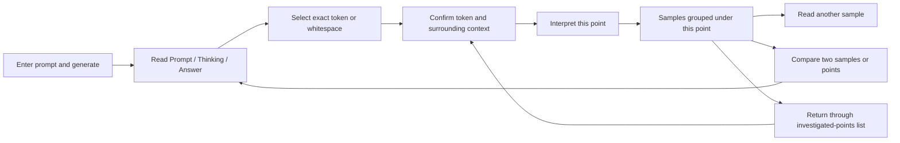

# Investigation interface

Status: accepted by Andrew; implemented in the browser interface. This redesign
concerns `app/`, the live experiment interface, not `web/`, the public project site. It does not change generation,
capture identity, the model pair or the meaning of an interpretation.

## Purpose and primary action

Developers and curious readers should be able to move through one generation,
choose an exact point, read an NLA sample in context, then compare it with another
sample or point. The primary action is **select a point and inspect its activation**.
The interface must support an extended investigation without requiring numeric
position entry or keeping a mental map of a reverse-chronological result feed.

Use the existing Plainsight design context: curious, practical and precise;
navy, ivory, brass and the established Plex type. The change is in information
hierarchy and interaction, not a new visual identity.

## Problems exposed by the rhyming walkthrough

- Token buttons become atomic inline boxes. Embedded newlines distort prose,
  paragraph breaks and punctuation; whitespace captures are hard to find.
- A long thinking stream pushes the answer far down the page.
- All NLA results accumulate in a separately scrolling column. The current
  selection and topmost result can refer to different points.
- Global interpretation numbers obscure the distinction between another sample
  of one activation and an interpretation of a different activation.
- Repeated words are ambiguous. Selecting a nearby “bit” instead of “wit” was
  difficult to notice until the explanation was read.
- Prompt text and generated control tokens are mixed in a single technical view.
- Completion and explanation-tag validity do not establish semantic fidelity.

## Layout

A compact experiment header retains the prompt identity, generation state and
model pair. Generation settings and the original prompt remain inspectable;
new generation is a deliberate action, away from investigation controls.

Desktop has three regions:

1. **Investigated points:** a compact navigation list grouped into Prompt,
   Thinking and Answer, ordered by source position. Each entry shows the exact
   token text, position and sample count. It is not a list of generated summaries.
2. **Generation reader:** tabs for Prompt, Thinking and Answer; readable inline
   text; search with previous/next match; visible selection and precise token
   navigation. Selecting a point from the list reveals its source tab and scrolls
   to it. User-authored prompt text remains distinct from chat control tokens.
3. **Selected activation:** the exact selected text, section, position, block and
   nearby source context appear immediately above its samples. Only samples for
   this point are shown. An explicit Compare action expands into two reading
   columns, with a common source-context header and a return-to-reader action.

The transcript has one bounded reading area for long thinking streams; search
and point navigation scroll within that area without moving the selected-activation
header out of view. No nested scroll container inside the interpretation. The page scrolls normally;
compact navigation and selection headers can remain sticky. Selecting another
point restores that point's sample choice rather than resetting to newest.

## Selection and temporal context

The authoritative mapping stays byte/token based. Inline spans render readable
text without inserting spaces between subword tokens. Selectable spans have
keyboard behavior, a roving focus target and accessible names. A Unicode glyph
spanning tokens keeps the existing contributing-position mapping; the UI must
show the resulting range and never silently substitute a single activation.

- Click a token; use arrow keys for adjacent tokens and Shift for a range.
- Search matches visible text, then maps each occurrence back to its contributing
  positions. Show the matched occurrence in surrounding text before interpretation.
- Label sections on every selected point: **Prompt**, **Thinking** or **Answer**.
- A contextual token strip makes boundaries explicit: `grab` · `␠it` · `,` · `↵`.
  Whitespace symbols are presentation labels only; original bytes stay unchanged.
- The reader preserves real newlines. In token-inspection mode, give standalone
  whitespace an explicit accessible target. Never invent a newline that was absent.
- Default to one point. Range selection states “N positions · N separate captures”.
  Each result remains keyed by its own position; never average vectors or imply
  a phrase-level activation.
- Context is split at the selected consumed token. Text before and including it
  was available at this point; later text is explicitly labelled as generated
  afterward. A final-answer activation includes the preceding thinking context.
- Control tokens are an optional advanced layer within their actual sequence
  location, not all appended to the prompt display.

## Samples and comparisons

“Sample 1 of 4” means four independently sampled explanations of this same
activation. Global request/variant identifiers remain in technical details.
“Generate another sample” adds to the selected point using the next seed; it
never creates a new target generation. Advanced controls expose sampling mode,
seed, temperature and output budget. Greedy duplicates are identified as such.

The Compare view shows two full, unedited explanations side by side with source
section, token, position and sample label on each. Default to two samples of the
current point; selectors can choose another investigated point. Same-point
comparisons state “Same activation, different samples”; cross-point comparisons
state both positions. Mobile stacks the two with persistent identity labels.
No machine-generated confidence score or automatic finding is introduced.

A completed background sample belongs to its original point even if selection
changes. Update its count/status in the list without changing the current reader,
selection, comparison or scroll position. Selecting a point with no result shows
an empty inspector and an Interpret action, never another point's explanation.

## States and copy

| State | What the interface shows |
| --- | --- |
| First visit / expired access | Existing connection panel, launcher-link field and remembered-access explanation |
| No experiment | Prompt composer; optional example prompt; concise workflow guidance |
| Loading / generating | Current phase; streamed thinking and answer in their own sections; Stop generation |
| Selection during generation | Exact context; “Available to interpret when generation finishes” |
| Retained, no selection | Reader and “Select a point in the text to explore its activation” |
| Selected, no samples | Exact token/context and Interpret this point |
| Queued / NLA loading | Status on the requested point, with progress in its sample slot |
| NLA streaming | Append text in the assigned sample; preserve other samples and reading position |
| Completed | Finished generation; stop reason in details, without an accuracy badge |
| Budget exhausted / stopped | Explicit partial-output label; preserve text and any other samples |
| Failed interpretation | Error scoped to that sample; retry does not regenerate target text |
| Network interrupted | Retain selection, text and samples; reconnect from cursor |
| Service restarted / run replaced | Explicit unavailable-run message; never apply old selection to a new epoch |
| Run near interpretation limit | Show remaining capacity and the service's bounds before submitting |

Shared wording: “NLA samples can invent details. Repeated claims are not proof.”
Raw tags, seed, temperature, stop reason, model revision and capture boundary are
available under **Generation details**. Display “Format: explanation tags present”
there; do not treat tag completeness as fidelity. Preserve incomplete and malformed
output with a clear status rather than hiding it.

## Responsive and accessibility behavior

At narrower desktop widths, the investigated-points list becomes a labelled
selector above the reader. On mobile, the selected source excerpt is immediately
above its samples, with a **Back to text** action that restores the source position.
Avoid three squeezed columns or competing scroll areas. Comparison stacks without
losing either source label. Controls meet 44px touch targets where appropriate;
text-token inspection uses a larger adjacent token navigator on touch devices.

Focus remains on the user's action during streaming. Announce selection and job
status changes politely; do not announce every generated token. Keyboard users
can navigate source sections, search occurrences, tokens, samples and comparisons.
Selection, errors and completed states must be distinguishable without color.
Reduced motion is respected. Text remains selectable and copyable as plain text.

## Content and scope

The review prototype uses the actual rhyming transcript and nine interpretations
from the walkthrough. It includes the mistakes and unsupported NLA details; it
does not turn them into curated successful examples. Six points span prompt,
thinking and answer. The prototype is a static saved-data review, not a second
inference application. Actions that would execute inference are labelled as
proposed behavior and do not contact the live service.

Implementation reuses the existing controller, capture mapping and API.
Point/sample grouping, source navigation, comparison and whitespace display are
browser responsibilities. Authoritative original-message ranges remain a protocol improvement; the
current provenance fallback is documented below.
Do not infer the user prompt by loosely stripping arbitrary control-token text.

Existing service memory, request and retained-result limits remain authoritative.
Multi-run history, persistent notebooks, semantic grading, automatic conclusions,
and steering are outside this design. Nothing here certifies NLA quality.

## Implementation notes

Use the impeccable interaction, spatial-design and responsive-design references
when implementing the selected direction. Keep established fonts and theme.

The current journal provides exact templated input and token positions, but no
separate original-message byte range. The browser keeps submission metadata per
origin and uses the original user text only when it uniquely matches complete
retained display groups. With missing or ambiguous provenance, the Prompt tab
explicitly shows **Model input**, including the template. It never guesses message
boundaries from delimiter spellings. Adding authoritative prompt ranges to the
protocol would remove this fallback across browsers.

Submitted job metadata is saved per epoch/run for streaming attribution after
refresh. A server completion replaces that provisional slot by request/job ID.
A request started in another browser without local metadata has global progress
until its terminal event supplies the capture identity. It is never attributed
to the current selection. The service remains authoritative for completion,
capture availability and capacity.
