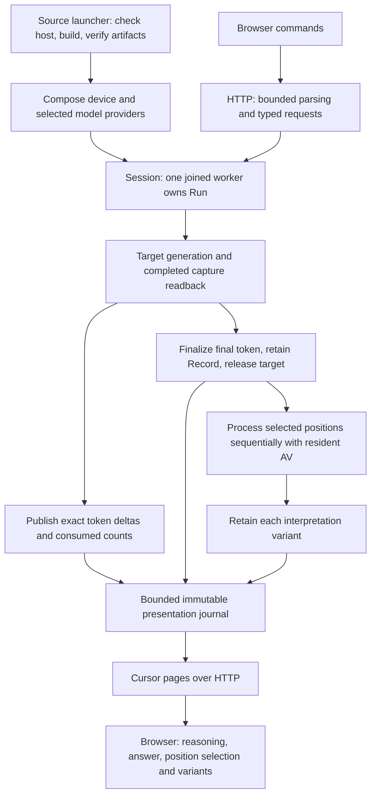

# Live experiment application

**Accepted — 2026-10-19.** This slice applies the accepted
[experiment overlay](logical-overview.md) to a source-built Linux/NVIDIA service
and its browser interface. Source launch, session ownership, HTTP transport and
browser exploration are implemented. Execution evidence and remaining platform
prerequisites are recorded in the work queue.

## Outcome and scope

From one command, build the service from source, acquire and verify the pinned
target/AV artifacts, and open a browser experiment. Enter a prompt, watch target
output, stop gracefully if desired, then select consumed tokens and compare
separate AV variants. Keep the reasoning, answer and interpretations distinct.
A Mac can operate the browser while Linux owns the GPU.

One service owns one GPU and one retained experiment. Starting another experiment
requires an explicit replacement action while no work is active; old links become
stale. A browser refresh reconnects to the same in-memory experiment. Server
restart loses it. Disk session export, reconstruction, multi-user scheduling and
Metal execution remain later work. The public `web/` site is independent.

## Algorithm and ownership

1. The launcher checks Docker, NVIDIA container GPU access, storage and the
   configured artifact cache before downloading. Build uses the existing pinned
   CUDA source environment. Artifact acquisition belongs to `scripts/models.py`;
   launcher coordination belongs to `scripts/run.py`.
2. Composition supplies verified target/AV providers, separate tokenizer/protocol
   identities, pair, sampler and explicit memory/context budgets. A persistent
   worker creates and owns the device and every `Run`. HTTP threads never call a
   `Run`, read its `Record`, or release GPU objects.
3. Admission reserves a bounded command slot and request identity. Acceptance
   means queued, not that prompt/model admission has succeeded. The worker runs
   ordinary `Run::generate`; preflight failures become explicit request outcomes.
4. Generation publishes newly appended IDs and completed consumed length after
   existing completion boundaries. An emitted token can precede its own capture.
   The observer adds no kernel, readback, RNG draw or synchronization. It runs
   on the generation thread, borrows only call-scoped data, and never does I/O.
5. Run decodes just the new IDs and advances a protocol-owned segmentation
   cursor. It reports target/AV role and operation identity to the session. The
   session appends owned, immutable presentation events. Raw capture vectors stay
   in `Record`; neither the journal nor browser receives them.
6. After generation returns, finalize Record and release target resources as
   today. Only then publish `target_retained` and make captures interpretable.
   A partial failure publishes the actual retained prefix and explicit absent
   captures. A failure with no materialized Record cannot offer interpretation.
7. An accepted bounded list of `(capture, settings, seed)` jobs runs sequentially.
   Requests made during target generation wait. Resolve each capture against the
   retained Record, never a browser character offset. An invalid/unavailable row
   yields a rejected job, not a substituted neighbor. AV weights stay resident;
   each attempt receives a fresh KV cache. One failed job does not silently erase
   the remaining jobs; stop the batch on a fatal device/closed-run condition.
8. Publish each attempt's exact output, tag status, outcome, settings and variant
   ID. Request/job IDs exist before VariantId does: preflight rejection may have
   no variant. Failed or canceled accepted attempts keep their recorded status.
9. HTTP readers borrow immutable event owners under a short lock, then serialize
   and send outside that lock. Slow clients do not hold the GPU worker. Shutdown
   stops admission, signals cooperative stop, drains/joins the worker, releases
   Run and device on their owner thread, then destroys publication storage.

`Session` adds concurrency around `Run`; it does not change Run into a concurrent
object. A single persistent worker avoids thread creation per token/request.
Cancellation uses a per-active-operation stop source. Copy that source under the
session mutex and request stop after unlocking; never run stop callbacks while
holding the mutex. No detached workers or callbacks that retain borrowed spans.

## Progress, segmentation and exact positions

Extend `inference/generation.h` with a borrowed observer accepting appended token
IDs, their first absolute position, prompt length and completed consumed length.
Report initial prompt IDs once, emitted IDs once, and subsequent consumed-count
advances without resending the whole prefix. A missing observer preserves current
behavior. Observer failure requests graceful cancellation and marks publication
failure; it does not masquerade as CUDA arithmetic failure or discard the Record.
Preallocate publication metadata when possible; reserve a terminal error slot.

Add a protocol-owned segmentation cursor to `text/protocol.h`. The Qwen3 kind
uses the same control-ID transitions as `segment`, carrying its state between
chunks. Chunked classification must concatenate to the existing whole-sequence
result, including malformed/nested delimiters. Batch `segment` and the cursor
share a transition rule. No thinking IDs move into HTTP or JavaScript.

A presented token carries its exact ID, absolute position, raw byte contribution,
mapped/unmapped status and segment kind. JSON uses base64 for raw token bytes,
which need not be valid UTF-8. Control and prompt tokens remain inspectable even
when hidden in the default transcript. Positions, IDs and capture keys remain
authoritative; text is a view. Browser decoding buffers split UTF-8 characters
and records every contributing token. A multi-token character selects an explicit
position range; the inspector lets the user choose an individual token. A
terminal incomplete sequence displays replacement text without changing bytes.

`consumed_tokens` is a progress watermark, not permission to interpret during
target execution. Availability is established from the retained Record when the
phase finishes. A selected window expands into independent jobs per position;
it never averages vectors or silently assigns one character to one token.

## Transport contract

Use same-origin HTTP JSON with cursor polling. While work is active, the browser
requests updates at most ten times per second, never overlapping requests. Idle
polling backs off; a disconnection uses bounded retry. This introduces up to one
poll interval of presentation delay. It is a tunable starting value, not a
throughput or latency claim. SSE/WebSocket remain possible A1 changes.

Use [cpp-httplib](https://github.com/yhirose/cpp-httplib) for HTTP framing,
connection handling and a fixed worker pool. Its documented blocking I/O makes
short bounded requests a suitable initial use. Version 0.62.0 and its source archive SHA256 are pinned in CMake; its MIT
license is retained in `docs/licenses/`. It supplies transport
only. Use the existing JSON dependency for strict wire encoding, with duplicate
keys, unknown fields, invalid enums, non-finite values and oversized inputs
rejected. No new inference framework or frontend build framework is required.

| Endpoint | Contract |
| --- | --- |
| `GET /api/v1/status` | Server epoch, current run, phase, supported pair/backend, configured limits, queued/active request IDs |
| `POST /api/v1/runs` | Client request ID, prompt, target settings and expected prior RunId for explicit replacement; 202 queued or 409 busy/stale |
| `POST /api/v1/runs/{run}/interpretations` | Request ID and bounded ordered list of captures/settings/seeds; 202 queued, with per-job eventual outcome |
| `POST /api/v1/runs/{run}/stop` | Request ID plus active operation/request identity; signals only that operation and cancels its remaining jobs; never a later operation |
| `GET /api/v1/runs/{run}/events?after=…` | Bounded ordered immutable events, next cursor and whether more are available; no long-held request |
| `GET /` and fixed asset paths | Packaged `app/` resources only, with correct MIME types; no model/cache directory serving |

Represent 64-bit IDs, event cursors and seeds as decimal strings on the wire;
JavaScript must not round them through Number. Include a random server epoch so
a restart cannot reuse an old browser request/cursor accidentally. Capture keys
include run, semantic site and absolute consumed-token position. The pair supplies
the site's block and boundary; the server never hardcodes 24.

Mutations carry stable client-generated request IDs. Under one admission lock,
check an existing receipt before stale-run validation, then validate and reserve
command plus receipt capacity before acknowledgement. The
same ID and canonical typed payload returns the original receipt; a changed
payload returns conflict. Retain receipts for the current run, including failed
and canceled jobs. Bound the ledger and reject further commands when full;
never evict an ID that could be replayed while its run is current. Retrying a
lost POST response cannot generate twice or create another variant. On explicit
replacement, retain the replacement receipt for the current run; stale requests
carrying the old expected RunId fail rather than replacing again.

An event page contains the current phase/status watermark and events after the
cursor, bounded by both count and encoded bytes. Keep the admitted journal for
the lifetime of the current run: reconnect starts from its last applied cursor,
and refresh can replay from zero. Deduplicate by sequence; reject gaps, future
cursors and epoch mismatches. Never advance a cursor past an event not included
in that page. Run replacement invalidates the old journal with an explicit stale
response; an in-flight response remains valid only for its labeled run/epoch.

Use 400 for malformed input, 404 for unknown resource, 409 for stale/busy/conflict,
413 for request-size limits, 429 for bounded capacity, and 503 for unavailable
service/device. Numerical/preflight errors after acceptance are request events,
not successful descriptions. Errors exposed to clients omit local filesystem
paths. Model bytes/metadata are acquired only through the trusted launcher.

Default published port binds host loopback. Docker may listen on all container
interfaces while Compose publishes only `127.0.0.1`. Explicit LAN binding is an
operator choice. Check allowed Host/Origin and a startup access token for API
requests; no wildcard CORS. Hand the token to the local browser in a URL fragment,
remove it after reading and retain it in session storage; never put it in logs or
query strings. Serve generated text as text nodes, never HTML. This is a local
experiment service, not an internet-facing multi-user deployment.

## Bounds and cost

Let N be admitted target tokens, A the cap per AV output, V the maximum variants,
B the admitted decoded bytes across target and all attempts, E the event count,
W HTTP worker count and R the maximum response bytes.

- Existing retained capture payload is `8192*N` bytes for this BF16 pair, owned
  once by Record. Publication adds no second vector copy or device readback.
- Presentation payload is `O(N + V*A + B + E)`; base64 wire bytes cost
  `4*ceil(raw_bytes/3)` plus bounded JSON metadata. Account for this separately
  from Record and tokenizer/provider allowances, including actual capacities.
- HTTP response working space is bounded by `W*R` plus bounded request buffers,
  serialization scratch and pinned event references. Explicit replacement cannot
  accumulate old journals: outstanding pages are bounded by W and page size.
- Command queue, total jobs, receipts, event count, event bytes and per-token bytes
  have explicit limits. Admission uses checked sums/products and reserves terminal
  outcome capacity. If progress exceeds its admitted budget, request graceful stop
  and expose publication failure; never silently truncate a successful result.
- Append/decode each delta once. No full-history decode, classification or JSON
  serialization on every token. Poll pages serialize only the requested events.
  Terminal metadata links prior output by range instead of duplicating all text.
- HTTP is off the generation thread. Small publication locks transfer owned
  event pointers; serialization, callbacks, filesystem and device calls stay
  outside them. Measure callback, lock and presentation overhead independently
  of clean inference timing. Do not introduce a lock-free queue without evidence.

The target context ceiling is 8,192 tokens, with a browser output default of
4,096 shared by thinking and answer. Admission checks prompt plus requested
output, including the chat template. AV keeps an independent 512-token context
and 256-token output default. Per-run allocation uses admitted capacity, not the
global ceiling: at 8,192 target tokens, KV is 1.125 GiB and raw retained captures
are 64 MiB, in addition to weights, scratch and metadata. A larger budget does
not force the model to generate to the cap. The frozen numerical cases remain
short; runtime capacity measurements do not establish full-context numerical
agreement with an independent oracle.

## Browser responsibilities

The browser has one prompt/settings area, a target transcript with reasoning and
answer sections, and an interpretation inspector for the selected position or
bounded window. Exact position, block, capture availability and variant settings
are inspectable. Comparing views does not imply that either is ground truth.

`client.js` owns wire validation, epoch/cursor handling and retries. It does not
retry a mutation with a new request ID. `controller.js` owns selection and pending
jobs. `view.js` renders that state, accessible keyboard navigation, progress,
stop, errors and raw-tag fallback. Disconnected, queued, loading, generating,
finalizing and retained states are distinct. Refresh rebuilds state from events;
no browser state can declare generation complete ahead of the service.

The inspector supports previous/next position, multiple variants and comparison
of neighboring tokens. Selection during generation may queue work, but it is
labeled waiting for target completion. Stop is not pause/resume. New experiment
explicitly replaces retained state. Visual composition can be reviewed with the
working interface; this document fixes behavior and data ownership.

## Files and implementation boundary

| Owner | Work in this slice |
| --- | --- |
| `experiment/session.{h,cpp}` | Persistent worker, admission, operation-scoped stop, receipts, bounded immutable event journal |
| `experiment/run.{h,cpp}` | Borrowed progress adapter, role/operation reporting, release-complete phase publication |
| `inference/generation.{h,cpp}` | Optional borrowed token/consumption observer at existing completion boundaries |
| `text/protocol.h`, `text/qwen3_chat.*` | Incremental segmentation cursor sharing the existing batch transition rule |
| `server/http.{h,cpp}`, `server/wire.cpp` | HTTP lifetime, strict JSON translation, IDs, authentication/origin checks, fixed assets and event pages |
| `main.cpp` | Parse local configuration, compose CUDA/model providers/session/server, orderly shutdown |
| `config/models.json`, `scripts/models.py` | Production target/AV role manifest, bounded acquisition, integrity and persistent revision-aware cache |
| `scripts/run.py`, `compose.yaml`, `Dockerfile`, `CMakeLists.txt` | One source-build launch command; runtime image/asset packaging; separate native developer path |
| `app/{index.html,app.css,client.js,controller.js,view.js}` | Live experiment interaction described above |

`session` belongs under experiment because scheduling/cancellation outlive HTTP
requests. `http` owns wire DTO encoding rather than leaking JSON into inference.
No per-event folder, generic messaging framework or alternative backend stub is
introduced. The existing change axes remain intact.

Production manifest entries copy the frozen target/AV repository revisions,
file sizes and hashes without editing the reference manifest. Select only needed
target/AV weights and metadata, plus licenses; omit AR downloads. Cache paths
include revision, reject traversal/symlinks outside the cache, stream to partial
files and atomically publish verified files. Do not execute model repository code.
Setup downloads missing files and verifies every artifact against pinned SHA-256
before atomically publishing a versioned receipt in the persistent cache. The
receipt binds the manifest to each file's size, modification/change times and
filesystem identity. A normal launch checks that small receipt and current file
metadata, then explicitly admits the prepared installation to the service. This
remembers a completed verification; it does not claim to cryptographically check
content on every launch. Changed/missing files or a changed manifest trigger
setup again; offline setup fails if any artifact fails its hash. Explicit
`--verify-models` forces full verification and repairs files when online.
`scripts/models.py` also always performs full verification/repair. Failed setup
leaves no valid receipt. Source rebuilds alone do not invalidate model setup.

Before HTTP readiness the service maps both archives and validates sizes,
bounded headers, index and extents. It retains the read-only mappings and shares
ownership with model bindings across turns. Only the active role occupies GPU
memory. The OS may reclaim mapped pages. Backing files must stay unchanged until
shutdown; changing model artifacts requires restarting. Direct service/archive
calls default to full SHA-256 verification; prepared mode is an explicit trusted
launcher precondition. Canonical model identities and numerical behavior remain
unchanged. Normal launch and model switching do no full weight hashing.

Docker builds the application locally from source. Weights are mounted read-only
at runtime; acquisition runs separately. Do not distribute a prebuilt application
executable. Host NVIDIA Container Toolkit availability remains a real acceptance
prerequisite; native execution does not count as container GPU verification.

## Verification and review boundary

Both corpora were queried for header design and again for implementation.
Implementation uses CP.22, CP.23, CP.41, CP.43 and CP.50 from cpp-guidelines,
and COPY.7/GPU.1 from the performance corpus. File headers describe their
application and the concrete algorithm.

Unit checks cover strict wire parsing, response bounds, segmentation chunk
equivalence, exact token-byte mapping and browser reducer invariants. They start
no threads, servers or GPU. Admission/retry and journal reconnect are exercised
through the real application integration; no claim of isolated session-policy
unit coverage is made. Do not test incidental chunk sizes or private queue layout.

The integration inventory is **five**: site, device resources, tiny numerical
target-to-AV, pinned 8B numerical target-to-AV, and the live application.
The application scenario replaces the standalone archive scenario. Actual startup
covers successful real-file verification/binding; adversarial filesystem cases
from the retired scenario are not claimed as preserved. Pure safetensors/parser
contracts remain in isolated units. Browser inspection uses the same application
flow, rather than adding another integration scenario.

The application scenario follows one real prompt through streaming, final capture,
selection, interpretation and reconnect using the production service. Numerical
cases retain the independent frozen target/AV fixtures, limits and original oracle.
Native/PTX execution and memory checks remain configurations of those cases.
Builds, formatting and clang-tidy remain separate checks. Verify Docker GPU access,
shutdown ownership and host/thread sanitizers as appropriate; report actual
hardware/workload evidence. Header syntax checking alone establishes none of this.
