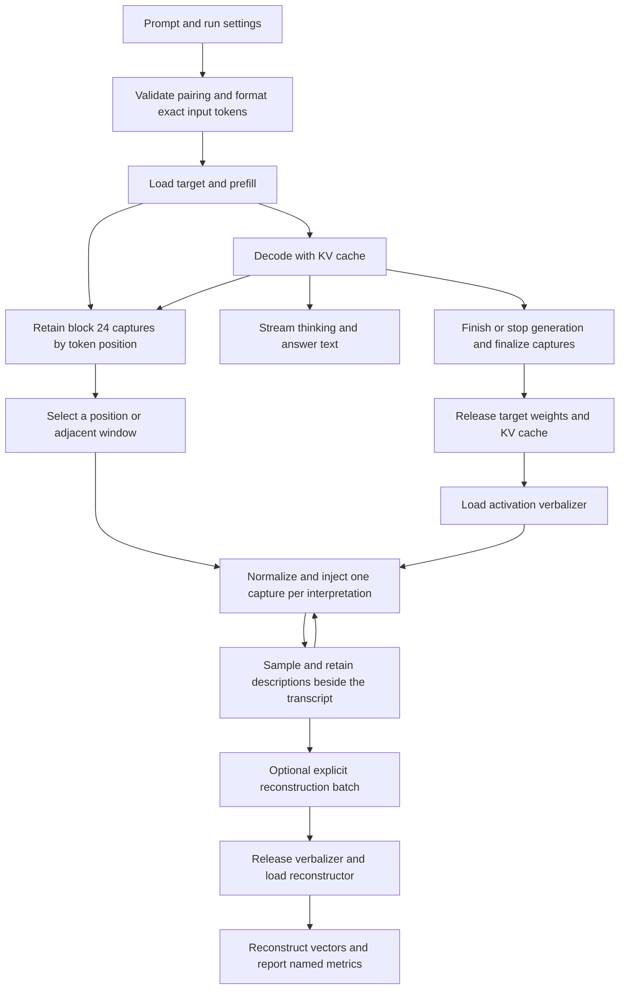

# NLA experiment algorithmic overlay

The accepted [GPU execution boundary](execution-boundary.md) defines device ownership,
GPU normalization/injection and autonomous prefill through final-token
consumption. Mathematical contracts and independent references remain fixed.

**Reviewed and accepted — 2026-10-17.** This defines the planned computation
and state flow for Dolittle. Change axes and file mapping precede engine
implementation. The [transformer execution overlay](transformer-execution.md) expands
the model computation inside these phases.

Dolittle lets someone run a thinking model, select moments in its transcript,
and read natural-language descriptions of the activations at those positions.
The first interaction is **generate and capture, then interpret on demand**.
Generated thinking, the answer, and NLA descriptions remain distinct views.

## End to end flow

Selections made during generation wait until the target phase finishes. A
window requests separate interpretations of its positions; it does not average
their activations. The diagram expresses dependencies, not threads or modules.

## 1 Establish the run

Resolve the target, activation verbalizer (AV), and activation reconstructor
(AR) from the [pinned manifest](../../scripts/validation/models-8b.json).
Check file integrity and the checkpoint-specific configuration before use.
The selected pair is Qwen3-8B with the community
`marco-bazzani/Qwen3-8B-nla` release. Its initial capture location is the output
of zero-based target block 24, after both residual additions.

That location is a requirement supplied by the NLA pair to the model's
configurable observation interface. The executor validates the requested site
against the model catalog and prepares capture storage before generation.
Block 24 is not embedded in the shared inference algorithm. The reference
harness may request other advertised sites for numerical checks without
claiming that this pair can interpret them.

Format the prompt using the target's tokenizer and chat template. Retain the
actual token sequence, including control tokens, the thinking-mode setting,
sampling settings, seed, and termination limits. Thinking mode changes the
formatted input and generated sequence; it does not introduce a different
transformer algorithm.

Admit the run only when the requested context, generation allowance, capture
storage, and working memory fit the supported configuration. Exact supported
limits remain to be measured. Reserve capacity to process the last emitted
token when finalizing captures.

## 2 Generate and capture

Prefill processes the prompt with causal attention and initializes the target
KV cache. Decoding then consumes one sampled token at a time. The final
normalization and vocabulary projection produce logits for sampling the next
token. The transformer overlay defines these operations.

Retain the block-24 output for every processed prompt and generated position
within the admitted run. Each capture is an immutable copy of the residual
vector before any normalization or scaling for the NLA. Reading or copying a
capture must not modify the target computation.

Keep token IDs authoritative. Display text is a derived view: a token may be a
control marker, part of a character, or contribute to a span together with
other tokens. Thinking/answer formatting must preserve a mapping back to the
original sequence, including positions hidden by the normal display.

### Capture alignment

For sequence token `x[p]`, capture `h[p]` is the block-24 state **after consuming
`x[p]`**. The remaining blocks use that state in predicting `x[p+1]`. It is not
the state that originally selected `x[p]`.

For example, prompt positions `0..P-1` are captured during prefill. Prefill's
last logits select generated token `x[P]`. Its own capture becomes available
only when decoding consumes it. The interface can therefore show an emitted
token before its capture is ready.

On normal completion, token limit, or a graceful user stop, process any final
emitted but unconsumed token to obtain its capture. This finalization performs
no further sampling. If execution fails or is forcibly aborted, preserve the
completed prefix and mark remaining captures unavailable. Never silently
substitute the preceding token's vector.

## 3 Retain the experiment and change phases

The first version has one active experiment on one GPU. Once generation and
capture finalization finish, retain the transcript and captures independently
of the target's temporary storage. Release its KV cache, workspaces, and
weights before making the AV resident.

| Retained information | Purpose |
| --- | --- |
| Model revisions, tokenizer/template identity, backend and precision | Identify the computation that produced the observations |
| Exact input and generated token IDs, display mapping, stop reason | Reconstruct the sequence and its presentation |
| Capture position, block, raw vector, dtype and availability | Bind an interpretation to an actual observation |
| Target settings and seed | Record how the trajectory was generated |
| AV input contract, settings, seed, output token IDs and completion status | Keep interpretation variants reproducible and inspectable |
| AR description input, metric definition and result | Associate diagnostics with the exact description tested |
| Phase/load timings and memory measurements | Separate inference cost from switching cost |

These are logical record requirements, not a commitment to an on-disk format
or session export feature. Seeds alone do not guarantee identical results
across backends or numerical implementations.

## 4 Interpret selected positions

Keep the AV resident while the user explores captures. Each request takes one
raw capture and the AV checkpoint's trained prompt and injection contract.
On the GPU, compute the vector's L2 norm in FP32, normalize it, apply the
trained scale, and replace the designated prompt token embedding. Device
validation gates inference on non-finite or zero-norm input. Check the injection marker and its neighbors against metadata.
The transformer overlay describes the remainder of AV execution.

The visible thinking text is not appended to the AV prompt. It is presented
alongside the resulting description for comparison.

Offer sampled descriptions with temperature 1 as the initial exploration
setting, retaining the full sampling configuration and seed. Other sampler
defaults need explicit selection during implementation. Preserve greedy
decoding for comparison with the reference probe. A request for another
interpretation creates a new variant of the same capture, without replacing
the previous result or rerunning the target.

Allow movement to neighboring positions and selection of a bounded window.
Process these requests sequentially initially; batching is a later scheduling
choice. Preserve each position and variant separately. Show raw output when
the expected explanation tags are missing, and label truncation or failure.
Repeated claims across a window may be informative but do not become a
confidence score.

## 5 Optionally reconstruct descriptions

Reconstruction is an explicit operation on one or more retained descriptions.
Complete or cancel active AV work, release the AV and its cache, then load the
AR and its separate value head. Format each description with the AR's trained
template and suffix. Produce a reconstructed vector from the final token's
residual after 28 blocks, bypassing final RMS normalization and the vocabulary
projection. Apply the learned value head.

Report a named metric against the corresponding capture, recording its
normalization and formula. Raw cosine can retain continuity with the reference
probe; it is a reconstruction diagnostic, not semantic confidence. It is not
the paper's dataset-level fraction of variance explained, which also needs a
defined dataset and mean baseline. Keep truncated descriptions identifiable
if the user elects to reconstruct them.

Returning to interpretation reloads the AV. Neither reconstruction nor model
switching changes the recorded target run. Explanation editing and steering
the target remain later extensions.

## Resource and lifetime constraints

The [reference comparison](../research/2026-10-16-nla-comparison/README.md)
measured sequential BF16 execution on a 24 GB RTX 3090 Ti. Target and AV
weights each occupy about 15.256 GiB; AR weights and its head occupy about
11.253 GiB. Target and AV cannot be simultaneously resident in that budget.
The combined downloaded bundle is about 45 GB.

For width `D`, retained positions `N`, and capture element size `b`, capture
storage is `N × D × b`. At `D=4096` and BF16, that is 8 KiB per position or
64 MiB at 8,192 positions. For the target, KV storage is
`2 × 36 × N × 8 × 128 × 2` bytes: 1.125 GiB at 8,192 positions.
These are derived payload sizes, not an established 8K operating limit.
Workspaces, allocations, transfer staging, and runtime overhead are additional.

Keep captures in an independently owned device arena. Copy each raw hook value
before scratch reuse and publish only its completion metadata. After target
shutdown the arena remains valid while weights, KV and scratch are released.
A later AV request reads the retained device row directly. Explicit diagnostics
may export a completed vector; live interpretation does not require an export.
Host weight caching and transfer strategy need their own measured budget;
this design does not assume all three models remain in host RAM.

The reference's warm loading times are not interaction latency guarantees.
Measure cold loading, repeated switching, prefill, decoding, capture overhead,
and explanation generation separately. Pause–interpret–resume is deferred;
the first stop ends generation rather than preserving a resumable target.

## Relationship to Anthropic's method

The [paper](https://transformer-circuits.pub/2026/nla/index.html) uses a frozen
target, activation-to-text verbalization, and text-to-activation reconstruction.
It samples AV output at temperature 1 and reports that practical inspection
mostly uses the AV without the AR. Selective interpretation and optional
reconstruction therefore fit the method.

The paper's adjacent-position analysis motivates window comparison. Its layer
sensitivity results also show why an absent description cannot establish an
absent internal representation. Block 24 is this checkpoint's supported
observation point, not a universally privileged thinking layer.

Some paper case studies add causal steering and independent corroboration.
This initial interaction does not establish those causal claims. The selected
community checkpoint is also distinct from the authors' released pairs.
Dolittle applies the method; it does not inherit the paper's empirical results.

## Checks before implementation is accepted

- Match exact formatted target tokens, AV injection inputs, and AR suffixes
  to the pinned reference conventions.
- Compare target logits and live cached captures with independent reference
  runs on identical token sequences. The existing probe used causal replay;
  it did not validate capture during cached decoding.
- Exercise prompt-end, first generated, thinking delimiter, final answer,
  token-limit, graceful-stop, and failed-run alignment.
- Verify that inspection leaves target outputs unchanged under the same
  numerical path, and that a phase switch leaves retained observations valid.
- Compare reconstructed vectors numerically. Generated prose agreement is
  not a substitute for these checks.

Numerical tolerances and workloads belong to the implementation verification
design. After reviewing these two overlays, derive change axes, then file
ownership and dependencies.
