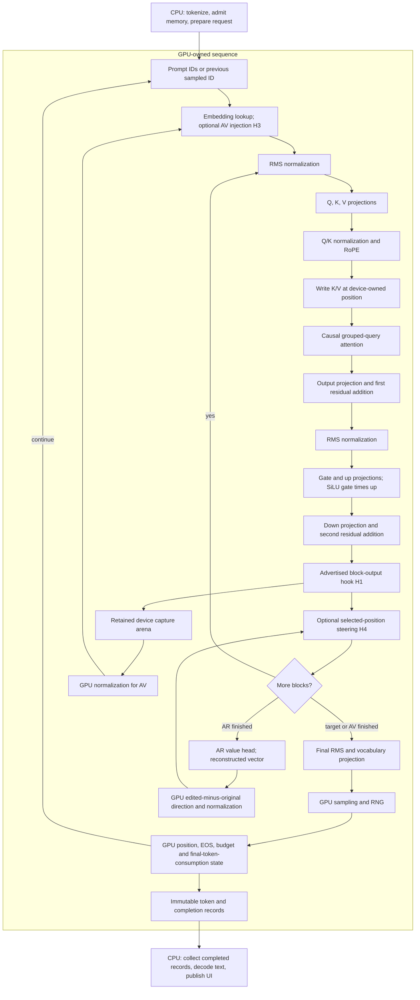

# Native Metal port

Architecture accepted 2026-10-21; execution foundation, transformer kernels and
native application composition are implemented.
Port the complete experiment to Apple Silicon:
target generation, retained activations, verbalization, reconstruction and
matched steering. Keep the existing browser interface and source launcher.
Use the same Qwen3-8B/NLA pair, BF16 storage and defined FP32 arithmetic and
rounding. Implement computation directly in C++ and Metal shaders.

## Reference implementations

These source comparisons inform the design; they do not replace the numerical
oracle or establish performance on Dolittle's workload.

| Inspected source | What carries into this port |
|---|---|
| Vigil, `866e65572a61a300ebb620382c279380ce42063a`: `backends/mlx/generate.cpp`, `sampler.cpp`, `kv_cache.cpp` | A deferred sampler returns a device array. The next forward consumes it before the current token is extracted for the host. Asynchronous evaluation overlaps execution and collection. |
| Serenity, `35e20d7`: `src/{metal,cuda}/device/submission.*`, `src/headless/run.cpp`, `docs/research/2026-10-19-cuda-backend.md` | Preserve shared meaning and application behavior; each backend owns submission, resources, synchronization and hardware-specific execution. Reuse submission resources, retire them after completion, and select the backend at composition/build time. |
| [llama.cpp Metal operations][llama-ops] and [device storage][llama-device] | Separate matrix-vector/small-batch work from matrix-matrix prefill. Select kernels by shape and device capability. Use multiple Metal buffer views when a mapped allocation exceeds `maxBufferLength`, keeping each tensor inside a view. |
| [vLLM-Metal decode pipeline][vllm-decode], [attention][vllm-attention] and [memory policy][vllm-memory] | Device tokens feed the next step before output is resolved. Tiled attention keeps query/output state in registers and reuses KV tiles. Memory admission accounts for the recommended working set and other reservations. |

Serenity supplies the porting pattern. Vigil and the open-source engines supply
inference mechanisms. Their inspected generation paths still use host scheduling;
Dolittle additionally requires generation to continue without the collector
advancing each token. Preserve that accepted execution boundary.

Use these references without importing their frameworks, quantization paths,
automatic FP16 conversions or serving-specific requirements. vLLM-Metal uses MLX;
it is a source reference here, not a proposed dependency. Likewise, Serenity's
frame pacing and rendering dependencies do not belong in the inference loop.

## Algorithm and execution boundary

The shared recipe describes the transformer. Metal decides how to execute it.
CPU code prepares requests and collects completed output. Generated tokens,
probabilities, random draws and stop decisions stay on the GPU data path.

This diagram combines separate target, AV and AR requests, not simultaneous
execution. Each request's role selects its head and hooks. The experiment
scheduler moves between requests after their completion.

H1 captures the residual after zero-based block 24's second addition, before
block 25's normalization: 4096 BF16 values per position, copied into independently
owned device storage. H3 replaces the trained marker embedding with a normalized
capture. AR runs its 28 blocks and value head. H4 applies the reconstructed
direction to the selected target residual during replay. These are this pair's
conventions; the hook catalog remains dynamic.

The [execution boundary](execution-boundary.md) and
[steering design](steering.md) define the full contracts, including consumption
of the final selected token and matched branch seeds.

## Metal scheduling

CUDA's conditional graphs implement `DeviceSequence`; they are not its portable
interface. Neither Vigil's inspected loop nor vLLM-Metal's one-step-ahead
pipeline provides Dolittle's complete autonomous sequence.

The candidate uses reusable indirect command buffers for prepared forward
bodies. Metal supports an [execution range supplied by a GPU buffer][apple-indirect].
A control dispatch updates position, phase and active ranges from device state.
After termination, later scheduled forward bodies have empty ranges.

Prepare a bounded command timeline from the admitted prompt and generation
budget before starting. It references reusable bodies rather than rebuilding
every layer's bindings for every token. Split the timeline into ordered command
buffers for completion reporting and submit the prepared work without token
readback. GPU decisions control whether a body runs. The collector observes
completed output windows; it never grants permission for another token.

Establish this scheduling mechanism on the device before designing the full
kernel headers. Check indirect execution dependencies, empty ranges,
cancellation, output visibility and prepared-timeline cost. Use supported Metal
completion/events for CPU visibility; do not transplant CUDA's mapped atomic
journal protocol unchanged. Cancellation needs an explicit supported
host-to-GPU publication mechanism independent of collection.

Command metadata scales with the admitted token budget; reusable bodies scale
with the model recipe. Measure preparation latency, metadata bytes and drain
time after early EOS. These costs differ from CUDA's conditional loop and must
appear in the sequence contract. Do not use cross-threadgroup spin barriers in
a persistent kernel without a forward-progress guarantee.

Follow Serenity's Metal 4 command-allocator and resource ownership pattern,
using Apple's pinned `metal-cpp` bindings and a compiled shader library. Initial
deployment proposal: Apple Silicon on macOS 26+, matching Serenity's Metal 4
baseline; first validation on M3 Max. Check capabilities at startup. M5-specific
tensor kernels in newer references are not the M3 implementation.

## Memory and model residency

`Run` owns a cache per trained model role under **R3 experiment scheduling**,
shared by CUDA and Metal. Each request uses fresh sequence/KV storage. The
retention decision follows this order:

1. Reserve the active request's KV, scratch, kernel workspace, capture leases,
   command storage and output records.
2. Require its weights to fit alongside that reservation.
3. Retain other useful models within the remaining budget. Evict idle models
   before refusing a request that can run sequentially.

Target and AV each occupy about 15.26 GiB in BF16 weights, about 30.51 GiB
together. AR and its head add about 11.25 GiB. The current 8192-position target
cache adds 1.125 GiB. Thus weight size alone cannot decide residency. Retaining
models does not imply running them concurrently.

On Metal, budget against the recommended working set, current allocations and
an explicit application limit. Unified memory is one physical pool. Expose
admitted and resident bytes so the scheduling decision is visible.

The executor uses one logical weight arena. Metal checks `maxBufferLength`;
arenas exceeding it use no-copy page-aligned views over one backing allocation.
Crossing operands receive overlapping views that contain the entire operand;
large transfers split at view boundaries. Aliases do not duplicate backing
charges. Mappings/staging survive all queued readers.

Admission conservatively reserves all non-parameter recipe tensors before
lifetime reuse, plus KV, captures, sampling, staging and command headroom.
After preparation the executor checks actual owned sequence buffers and native
command allocator bytes before start. Opaque driver/pipeline allocations still
need headroom; CUDA has no per-executable graph-memory query. Unified accounting
also charges mapped checkpoint payloads because sharing with uploaded weights
has not been established. `Run::retained_model_bytes()` exposes cached ownership;
`release_models()` releases idle weights while leaving records/captures usable.

Keep the existing preallocated contiguous KV strategy for the port. Paged and
rotating caches remain separate cache-family implementations. vLLM's attention
tiles and reductions are useful without importing its multi-request page pool.

## Kernel strategy

Design efficient prefill and decode together:

| Work | Metal implementation direction |
|---|---|
| Decode projections | Cooperative vector loads, SIMD-group reductions and shape-specialized matrix-vector kernels; reusable pipelines and bindings. |
| Prefill projections | Tiled matrix-matrix work, reusing weights across prompt rows. Evaluate M3-supported SIMD-group matrix operations against required BF16/FP32 arithmetic before selecting them. |
| Attention | Separate prefill and single-query paths. Retain scores when they fit; otherwise recompute in bounded KV tiles. Round normalized probabilities before PV and preserve the fixed reductions. See Target kernel design below. |
| RMS, RoPE, SwiGLU | Cooperative reductions and vector operations. Fuse only when specified BF16 rounding and hook boundaries remain intact. |
| Sampling and state | GPU RNG, temperature/top-p/greedy selection, EOS and position updates. No host random draw or sampled-ID feedback. |
| NLA operations | Device capture copies, normalization, embedding replacement, AR value head and steering; independent capture ownership across model changes. |

Some reference kernels use half-valued intermediates or different softmax
details. Do not adopt those silently. Preserve explicit conversion points and
the [numerical portability contract](numerical-portability.md): exact
same-backend replay, native FP32 elementary functions and operation/dtype
tolerance checks against independent equations. Freeze oracle inputs and limits
before evaluating alternate reductions/matrix instructions. Find the first
divergent operation when a candidate fails; do not change the oracle to admit it.

## Change axes and files

Keep the accepted [change axes](change-axes.md) and
[file mapping](file-mapping.md). Add implementations inside existing families.

| Ownership | Files and seams |
|---|---|
| X4 Metal resources, queues and capabilities | `src/gpu/metal/{device.h,device.cpp,backend.h,metal_cpp.cpp}`; explicit allocation and working-budget capabilities in `src/gpu/device.h` |
| X5 Metal operations and prepared sequence | `src/kernels/metal/operations.cpp`, `launch.h`, shaders for embedding, projection, normalization, rotary, attention, elementwise, sampling, decode, injection and steering |
| X1 preparation/placement | `src/inference/executor.*`, `storage_plan.*`; stable multi-buffer bindings, admitted workspaces and command costs |
| R3 model retention | `src/experiment/run.*` applies `src/experiment/model_retention.*` decisions after reserving the complete request |
| Composition/build | `src/main.cpp`, CMake files and a Metal library helper; select the backend once, remove unconditional CUDA startup labels/includes |
| Launcher/tooling | `scripts/run.py` and tooling docs; native macOS build/run, Linux Docker/NVIDIA, existing verified-weight reuse and application entry point |

Tokenizer, chat formatting, Qwen3 recipe, NLA conventions, records, HTTP and UI
remain shared. Tensor representations and cache strategies remain explicit
families. Hardware resource handles and shader-specific layouts stay behind
backend boundaries, as Serenity's port demonstrates.

## Delivery

Deliver three complete phases, reviewing their file headers before implementation:

1. **Execution foundation and memory policy.** Native build, resources,
   prepared scheduling, completion/publication, cancellation, placement and
   budget-aware residency. Establish autonomous progress with collection
   deliberately delayed and account for prepared command storage.
2. **Complete target generation and capture.** Efficient prefill/decode,
   preallocated KV, GPU sampling/state and dynamic hooks. Compare logits,
   caches and captures with frozen independent fixtures. Profile GPU execution;
   report TTFS and steady-state tokens/s separately from loading/preparation.
3. **Complete local experiment.** AV interpretation, AR reconstruction,
   matched steering, native source launch and UI streaming. Verify sequential
   and retained-model operation, repeated requests and cancellation.

Before C++ header design and again before implementation, query both local
corpora and cite retrieved rules in file comments. This proposal consulted
Core Guidelines **R.1** (resource lifetime), **C.122** (backend separation), and
performance rules **GPU.1** (device data/control), **GPU.6** (batch/reuse work),
**GPU.7** (overlap and resource lifetime), **GDSA.4** (cross-workgroup progress).

Keep strict warnings, formatting and clang-tidy. Use Metal API/shader validation
and GPU profiling alongside numerical comparisons. Unit tests cover pure
admission, placement and state contracts. Revise the existing five-scenario
integration inventory for backend coverage of the same interactions; do not
hide unrelated workflows under parameterization or exceed five. Preserve CUDA
coverage when shared interfaces change.

The execution foundation and target kernels are implemented. Whole-model numerical budgets are diagnostic under the accepted
[portability contract](numerical-portability.md). Operation accuracy and exact
replay remain required. The native application uses the same Session and Run
composition, selecting the Metal device at build time.

## Target kernel design

The approved headers now have kernel implementations. The foundation is
committed as `1006866`. This phase adds the complete target
forward/generation path to the existing shared executor, including GPU sampling
and dynamic capture hooks. The full experiment and native source launcher now
use this backend through the shared Session/Run composition.

```mermaid
flowchart LR
  subgraph Preparation[Before sequence start]
    Recipe[Shared recipe and BF16/FP32 policy] --> Plan[Validate shapes; select Metal kernels]
    Plan --> Allocate[Admit weights, KV, scratch, constants and sampler]
    Allocate --> Setup[GPU frequency table, attention scale and RNG initialization]
    Setup --> Record[Record prefill, tail, head and decode bodies]
  end
  Record --> Sequence[Existing GPU-controlled timeline]
  subgraph Body[One recorded transformer body]
    Embedding[Embedding] --> Norm[RMSNorm]
    Norm --> QKV[Q/K/V projection]
    QKV --> QKNorm[Q/K head normalization]
    QKNorm --> RoPE[RoPE; K/V append at device position]
    RoPE --> Attention[Causal GQA; FP32 probability rounding before PV]
    Attention --> Out[Output projection and residual add]
    Out --> MLP[RMSNorm; gate/up; SiLU times up; down projection]
    MLP --> Residual[Second residual add]
    Residual --> Hook[Dynamic block-output capture hook]
    Hook --> Next{More blocks?}
    Next -->|yes| Norm
    Next -->|no| Final[Final RMSNorm and vocabulary projection]
    Final --> Sample[GPU sort, binary64 CDF and RNG selection]
  end
  Sequence --> Embedding
  Sample --> State[GPU token, EOS and position state]
  State --> Sequence
  Hook --> Capture[Independent GPU capture lease]
  State --> Events[Completed output windows]
  Events --> CPU[CPU collection and text decoding]
```

The diagram shows the whole body; prefill uses the final active row for the
vocabulary head. The timeline already separates body execution from head and
selection. Captures observe the advertised producer before its next consumer.
The selected Qwen3 pair uses block 24, but kernels receive hook bindings rather
than a hard-coded block number.

### Numerical choices

Three decisions make the implementation concrete:

1. **Prefill reuses weights while keeping the current dot-product order.**
   Decode cooperates across feature lanes. Prefill loads each weight once for
   four or eight prompt rows and stages input tiles. Both keep the existing
   16/32 FP32 partial sums. llama.cpp's Metal matrix paths provide useful
   tiling examples, but its SIMD-group matrix intrinsic does not expose that
   reduction order, so it is not the initial implementation.
2. **Attention normalizes each probability before multiplying V.** The earlier
   online-softmax direction is replaced by retained scores for bounded contexts
   and three-pass recomputation for larger contexts. Each path preserves the
   existing dot, denominator and two-range PV reductions. The three-pass path
   reuses KV tiles across prompt queries and never allocates a global score
   matrix. This follows the actual numerical contract in `kernels/operations.h`.
3. **The existing binary64 operations stay on the GPU.** Metal does not expose
   a native `double` type. Sampling currently uses binary64 weights/CDF;
   RoPE computes its inverse frequencies through binary64 `pow`. An isolated
   integer-backed arithmetic layer preserves those precisions. RoPE creates
   its small FP32 frequency table once on the GPU; sampling uses the layer
   for each distribution. Transformer tensors and accumulators remain BF16/FP32.
   The [Metal language specification][metal-spec] defines the type restriction.

Basic binary64 operations require nearest/even arithmetic and independent
boundary-vector checks. Exp/pow use the pinned OpenLibm algorithms as the
numerical design reference, with their coefficients and notices retained if
adapted. Transcendental results are checked separately; the independent model
fixtures and acceptance limits remain unchanged. Sampler timing is reported
separately so the cost of software binary64 is visible.

### Files and resource ownership

Each file starts with its inputs, equation, ordered operations, lane/tile
mapping, storage bound and corpus citations. The files below implement the
Metal backend and are registered with the native build.

| File under `src/kernels/metal/` | Responsibility |
|---|---|
| `launch.h` | Pure geometry and threadgroup-storage planning; numerical partitions do not depend on row count. |
| `operations.cpp` | Implement the shared prepared-operation API; cache pipelines, validate native views, retain immutable argument snapshots and record dispatches. |
| `common.metal` | Exact BF16 conversion and fixed FP32 reduction helpers. |
| `numeric.metal` | Software binary64 arithmetic for sampling, frequency and attention-scale setup. |
| `elementary.metal` | Split FP32 exponential range reduction and subnormal result construction for attention/SiLU. |
| `projection.metal` | Cooperative decode and tiled prefill with weight reuse. |
| `normalization.metal` | Residual/head RMSNorm with both required storage-rounding boundaries. |
| `rotary.metal` | GPU frequency setup and split-half rotation using device position. |
| `attention.metal` | Retained-score decode and bounded tiled recomputation/prefill, with causal GQA. |
| `embedding.metal`, `elementwise.metal` | Embedding, residual addition, SwiGLU and exact row copies. |
| `sampling.cpp`, `sampling.metal` | Prepared sampler ownership, stable filtering, binary64 scan, MT19937-64 and terminal state. |
| `injection.cpp`, `injection.metal` | GPU normalization and marker-replacement input ownership. |
| `steering.cpp`, `steering.metal` | Reconstruction difference and one-row residual mutation. |

The shared executor directly references injection/steering interfaces, so this
kernel pass also implements those small backend primitives. That avoids target-only
link stubs or CPU fallbacks. The complete AV/AR/steering workflows and native
source-launch application now pass on the M3 Max.

The X4 command recorder retains declared threadgroup memory lengths and uses a
per-device pipeline cache. It applies those lengths when sealing each indirect
command. Buffer and pipeline allocations enter the residency set together. Every recorded parameter snapshot stays
immutable until completion. The live timeline allocates nothing and receives
no per-token CPU updates. Direct diagnostic submissions retire their own
constant storage by completion before reuse.

Initial on-chip budgets are explicit:

| Kernel path | Storage/cost to admit and measure |
|---|---|
| Prefill projection | Four/eight rows x 128 FP32 features: 2/4 KiB shared input; four/eight register accumulators per lane. Two barriers per input stage. |
| Staged RMSNorm | `4*(D+32)` bytes; use the register/reload path when that exceeds device limits. |
| Retained-score attention | `4*(N+d+256)` bytes for at most 4096 visible keys, additionally limited by device capacity. |
| Tiled prefill attention at d=128 | A 32-key FP32 K or V tile: 16 KiB; four Q rows: 2 KiB; score tile: 512 bytes, plus declared reduction state. K/V reuse the same staging at separate phases. |
| RoPE setup | `d/2` FP32 frequencies, reused across positions/heads; no growing trig table. |
| Sampling | O(V) fixed arena for keys, histograms, binary64 prefixes, RNG and stop mask; no storage growth during generation. |

M3 projection measurements select eight prompt rows: it reduces time against
the four-row variant for the tested Qwen3 projection shapes. Arithmetic
partitions remain independent of that tile choice. Reuse the existing numerical
workflows for Metal instances of the same interactions, keeping five integration
workflows overall. Check full/chunked/decode agreement, logits, captures, KV,
sampler draws and final-token consumption. Profile release builds for prefill,
decode, sampling and preparation, then report TTFS and tokens/s independently
of model loading. CPU collection must remain optional for GPU progress.

Additional numerical references read for this design:

- [Berkeley SoftFloat 3e][softfloat]: binary64 operation and rounding contracts.
- [OpenLibm exp][openlibm-exp] and [pow][openlibm-pow], commit
  `5fe399749f9276eaa0b8403e507470da05cbbb3f`: range reduction and coefficients.
- [Metal-Float64][metal-float64] and [metal-softfloat][metal-softfloat]:
  software arithmetic approaches on Apple GPUs; no dependency added.

Both local corpora were searched again for this header pass. Core **I.7**,
**SL.con.3**, **R.1** cover results, bounds and lifetime. Performance **GPU.1**,
**GPU.2**, **GPU.5**, **GPU.6**, **GPU.9**, **GDSA.2** and **GDSA.16** cover the
GPU boundary, lane layout, reuse, prepared dispatch, storage and fixed reductions.

## Foundation contracts

The accepted design maps into these concrete units:

| Header | Contract |
|---|---|
| `src/gpu/memory.h` | Backend capabilities/usage snapshots and owned memory footprints, with unified physical bytes counted once. |
| `src/experiment/model_retention.h` | Scheduler policy for retaining/releasing models after reserving the next request; no device operations or loading. Native GPU residency belongs to X4. |
| `src/gpu/metal/device.h` | Native Metal device ownership and required capabilities. |
| `src/gpu/metal/backend.h` | Private checked native bindings; stable owners through completion. |
| `src/gpu/metal/buffer_views.h` | Pure large-allocation view placement with whole-operand containment. |
| `src/gpu/metal/submission.h` | Complete prepared timeline, independent publication windows, command-allocator lifetime and completion. |
| `src/kernels/metal/sequence_plan.h` | Bounded prefill/head/decode schedule and output capacity, with an immediate first-selection publication boundary. |
| `src/kernels/metal/decode.h` | GPU control flow, pending-token consumption, cancellation and ICB ranges. |

`Run` owns the role-scoped model cache. `DeviceSequence` implements the shared
interface and reports prepared resources before execution admission. CUDA also
uses the new retention policy; its sequence arithmetic is unchanged.

Immutable control arguments and tables are reused across matching steps. Hook
constants share one bounded arena. Each publication window gets separate shared backing. A completion event makes
that window readable; subsequent GPU work cannot modify its resource. This
avoids concurrent CPU/GPU access to the live journal. Window preparation and
submission still occur independently of collection.

Cancellation uses a separate GPU control dispatch writing one
device-coherent atomic flag. It has no payload and no waiting kernel; initialization
precedes both queues. This uses the device coherence and atomic rules in the
[Metal Shading Language specification](https://developer.apple.com/metal/Metal-Shading-Language-Specification.pdf),
sections 4.8 and 6.16. The M3 device integration exercises cancellation during
autonomous execution and confirms consumption of the final selected token.

Hardware discovery confirms that the current M3 Max's maximum allocation
exceeds a complete model arena. Multi-view placement remains a bounded fallback
for smaller limits, not an excuse to split every tensor or add a paging layer.

[llama-ops]: https://github.com/ggml-org/llama.cpp/blob/0a1ef309cdbb9f2024f58a38fb4c42352c5db569/ggml/src/ggml-metal/ggml-metal-ops.cpp
[llama-device]: https://github.com/ggml-org/llama.cpp/blob/0a1ef309cdbb9f2024f58a38fb4c42352c5db569/ggml/src/ggml-metal/ggml-metal-device.m
[vllm-decode]: https://github.com/vllm-project/vllm-metal/blob/55a3352cd7a16ce19825173e5252ca37a26e740a/vllm_metal/v1/decode_pipeline.py
[vllm-attention]: https://github.com/vllm-project/vllm-metal/blob/55a3352cd7a16ce19825173e5252ca37a26e740a/vllm_metal/metal/kernels_v2/pagedattention_tiled.metal
[vllm-memory]: https://github.com/vllm-project/vllm-metal/blob/55a3352cd7a16ce19825173e5252ca37a26e740a/vllm_metal/v1/cache_policy.py
[apple-indirect]: https://developer.apple.com/documentation/metal/mtl4computecommandencoder/executecommands(buffer:indirectbuffer:)

[metal-spec]: https://developer.apple.com/metal/Metal-Shading-Language-Specification.pdf
[softfloat]: https://www.jhauser.us/arithmetic/SoftFloat-3/doc/SoftFloat.html
[openlibm-exp]: https://github.com/JuliaMath/openlibm/blob/5fe399749f9276eaa0b8403e507470da05cbbb3f/src/e_exp.c
[openlibm-pow]: https://github.com/JuliaMath/openlibm/blob/5fe399749f9276eaa0b8403e507470da05cbbb3f/src/e_pow.c
[metal-float64]: https://github.com/philipturner/metal-float64/tree/01306dec8f44f4315ad018b2f7b24c162320ffeb
[metal-softfloat]: https://github.com/guyfischman/metal-softfloat/tree/8b6c592e2e383040fe2778bed8dda7904df284b1
