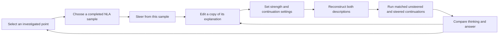
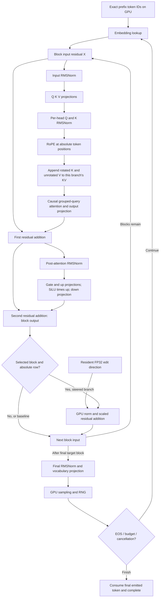
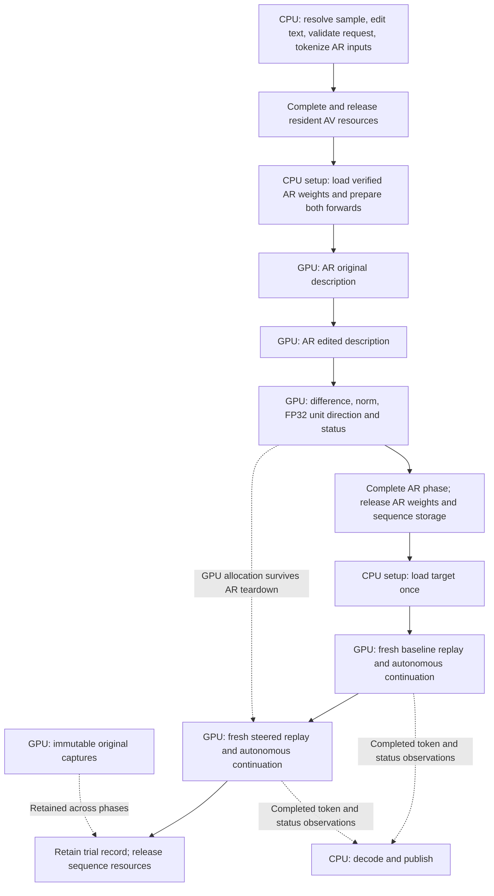

# Editing an interpretation and steering a continuation

Implementation: available in the Linux/NVIDIA application.

Edit an NLA explanation to steer a new continuation. This design covers the
algorithm, GPU execution boundary, interface and source layout.

## What the user does

Select a completed interpretation, edit its explanation, then compare two new
continuations from the same point: **Unsteered** and **Steered**. Preserve the
original generation, captures and interpretations. A comparison belongs to that
investigation; it does not replace the run or submit the edited explanation as
a new target-model prompt.

Start with one explanation, one target position and one steering strength per
comparison. Both continuations share the exact fixed token prefix, seed,
temperature, sampling policy, thinking mode and continuation budget. Each has
fresh KV state. No automated sweep, averaged directions, multi-position edits
or recursively branched investigations in this first feature.



## Paper method and our model pair

In [Anthropic's Planning in Poetry case study and appendix](https://transformer-circuits.pub/2026/nla/index.html),
the authors edit an explanation at the newline following “grab it”: rabbit,
habit and carrots become mouse, house and cheese. They reconstruct both
descriptions and add their normalized difference to the original activation at
that token and the NLA's trained layer. Direct replacement with the edited
reconstruction is a separately discussed experiment, not this method. The
appendix reports a change in Opus completions at strengths of at least 0.5,
with imperfect and sometimes degraded results.

Our [selected pair](https://huggingface.co/marco-bazzani/Qwen3-8B-nla)
includes the missing activation reconstructor (AR): 28 Qwen3 blocks followed
by a learned, bias-free 4096-by-4096 value head. Its extraction point is block
27's output at the final input token, before final model normalization. It
returns a vector directly.

The selected pair supplies the trained AR input:

```text
Summary of the following text: <text>{explanation}</text> <summary>
```

Encode the complete formatted string with the AR tokenizer and its declared
special-token behavior. Do not apply the target chat template. Validate the
final token IDs against the pinned suffix `[1318, 29, 366, 1708, 29]`.
These are pair conventions, not constants in shared execution.

The relevant upstream implementation is
[NLACritic](https://github.com/kitft/nla-inference/blob/main/nla_inference.py).
Pin its source revision, reference environment and numerical fixtures for
independent verification.

## Algorithm and numerical boundaries

Let `p` be the selected absolute consumed-token position, `l` the pair's target
block, and `D` its residual width. For this pair, `l=24` and `D=4096`.
Let `z0` be the exact extracted explanation from the selected sample, `z1` the
user's edited text, and `alpha` a finite, nonnegative strength.

1. Tokenize the two trained AR prompts independently. The original and edited
   descriptions can have different lengths. Each uses fresh AR sequence state.
2. For each prompt, run embedding lookup and all 28 AR blocks. Take the final
   input token's residual after block 27; apply the value head, without final
   RMSNorm or vocabulary projection. This produces `r0` and `r1`, each `[D]`.
3. Widen the stored BF16 results to FP32, then compute
   `delta[i] = r1[i] - r0[i]`. Compute its L2 norm on device and retain
   `u[i] = delta[i] / ||delta||` in FP32. Do not normalize `r0` and `r1`
   independently before subtracting. The AV injection scale of 150 and AR
   training MSE scale of 64 are not steering strengths.
4. Replay the fixed target prefix from empty KV state. Immediately after the
   selected block's second residual addition, obtain the live row `h[p]`.
   Compute its L2 norm on the GPU, then update that row only:

   ```text
   beta = alpha * ||h[p]||
   h_steered[p, i] = BF16(FP32(h[p, i]) + beta * u[i])
   ```

   This is `h' = h + alpha * ||h|| * delta / ||delta||`. Norms, subtraction,
   division, scaling and addition use FP32, with explicit reduction order and
   rounding points in the kernel contract. Transformer storage remains BF16
   with FP32 accumulation.
5. Continue through the remaining target blocks, final RMSNorm, vocabulary
   head and the existing GPU sampler. Continue decoding normally. The
   intervention is not repeated on later tokens or at other layers.

Validate finite AR output, direction norm, live activation norm and stored
intervention output on device. A zero/nonfinite direction at positive strength
fails explicitly before target generation. Identical explanation bytes can be
rejected before loading AR; numerically identical reconstructions need the
device check. Zero strength bypasses mutation exactly, without division by a
possibly zero direction.

Read-only captures remain immutable. The intervention mutates the branch's
working residual, never the retained source capture. Baseline capture equality
and injection before/after vectors are checked through explicit diagnostic
exports in numerical verification, not live host vector processing.

## Full transformer flow and the mutation boundary

The existing [complete transformer equations](execution-boundary.md#2-full-target-and-av-transformer-algorithm)
remain authoritative. This extension inserts one declared operation between
the selected residual producer and every downstream consumer. The model
advertises which boundaries support it; shared execution must not search for
block 24 or infer a boundary from an operation's position in a list.



The AR follows the same block equations for 28 blocks, then exits to its value
head. It does not enter the target's final RMSNorm/vocabulary/sampling tail.
The target runs all 36 blocks. Its block-24 intervention occurs after that
block's K/V has already been written; later blocks receive the edited residual
and write different K/V as a consequence.

Observation and intervention are separate capabilities. For a requested
observation at an intervention boundary, define the capture as the post-edit
value seen by downstream consumers. A diagnostic request may additionally
retain the pre-edit row under an explicitly distinct identity. Never silently
change the read-only hook API into a callback that can write tensors.

The executor orders: producer completion → intervention → post-edit observation
copy → downstream consumers. It must extend the working row's storage lifetime
through these operations. This remains true when adjacent block-output and
block-input observations refer to the same logical value.

## Exact replay and comparison

Let `P` be the original prompt length and `p` the selected consumed position.

| Selection | Fixed tokens used by both branches | First newly sampled position |
| --- | --- | --- |
| Inside the original prompt, `p < P` | Entire original prompt `[0, P)` | `P` |
| Inside generated thinking or answer, `p >= P` | Original prompt and generated prefix `[0, p+1)` | `p+1` |

The intervention applies at `p` during replay in either case. For a prompt
selection, the remaining original prompt is supplied unchanged after `p`.
For a generated selection, discard the original generated suffix from branch
input. Never replay it as if it were new model output. Reject a branch whose
fixed generated prefix already ends at a generation stop token.

Do not decode and retokenize the prefix. Exact IDs, absolute RoPE positions and
the original prompt boundary survive replay. Replaying the generated prefix
also restores the text-classification cursor so an answer branch does not
incorrectly restart inside thinking. This classification is CPU presentation
work and never controls inference.

Run the unsteered and steered branches with independent, fresh caches and RNG
states initialized to the same comparison seed. Both start drawing randomness
at the first new token. The control is a newly generated continuation, not a
promise to reproduce the original suffix, whose RNG history may differ.

**Optimization:** retain target weights across the two branches. Prepare KV
capacity before each sequence; do not grow it in decoding. Initially retain
the existing per-sequence allocation strategy. Reusing the original run's KV
would be incorrect: upper-layer entries depend on the intervention, and later
original tokens belong to a different trajectory. Prefix-cache reuse is not
part of this feature.

For chunked prefill with first absolute position `S` and active rows `B`, apply
the edit iff `S <= p < S+B`; the local row is `p-S`. Device state determines
that condition. A one-shot applied flag and terminal count verify exactly one
application. A missing or repeated positive-strength application fails the
trial. This works at chunk boundaries without host per-token updates.

## Device ownership and model phases



The CPU handles admission, tokenization, model transitions and resource
retirement. Once submitted, each AR forward and each target sequence reaches
completion without a CPU acknowledgement. AR prefill and final-vector extraction
need an explicit forward-only device execution mode; setting a generative
request's budget to zero must not accidentally skip the head.

Only tokens, scalar diagnostics and terminal statuses leave the GPU in the live
path. No AR vector readback, CPU subtraction/norm, host-selected injection row,
CPU random draws or per-token kernel submissions. Device status gates invalid
work; coarse phase completion may report failure and prevent loading the next
model. Cancellation can stop between phases or signal the active device request.
All users complete before any borrowed storage is retired.

The direction owns its allocation independently of AR scratch and weights.
The prepared intervention borrows it through target completion. Original run
capture leases remain alive throughout. Do not retain an entire AR model merely
to keep one result vector valid.

### Expected resource cost

For `D=4096`, two BF16 reconstructions total 16 KiB; one FP32 direction is
16 KiB. Norm/status/workspace and optional diagnostic rows are additional
bounded allocations. Existing target captures cost 8 KiB per position, up to
64 MiB for 8,192 positions at one site.

The measured checkpoint inventories imply approximately 15.26 GiB of target
or AV weights and 11.25 GiB of AR weights. Admission adds the retained run,
sequence KV, graph state,
scratch, output publication and staging allocations to the active phase.
Target KV at capacity `C` costs `2 * 36 * C * 8 * 128 * 2` bytes, or 1.125 GiB
at `C=8192`; 28-block AR KV, if used for chunked forward execution, costs
`2 * 28 * C_ar * 8 * 128 * 2` bytes and is released after each description.

Peak device cost is the maximum of the AR and target phases plus retained
owners, not their sum. Sequential execution is required on the 24 GiB baseline.
Expect two AR forwards, two target prefix replays and two continuations per
comparison. Reusing resident target weights avoids a second target upload. AR-to-target
loading still contributes to comparison latency.

## Checkpoint acquisition and binding

Extend the normal prepared model bundle with the pinned `ar/` artifacts already
inventoried in `scripts/validation/models-8b.json`. Reuse their exact hashes;
do not query a moving revision or download arbitrary remote Python code. Setup
downloads missing files and verifies SHA-256 once. Launch uses the existing
receipt validation; explicit repair performs full verification again.

The AR shard files and `value_head.safetensors` contain BF16 tensors, while the
pinned AR config declares `dtype: float32`. Make this an explicit compatibility
exception for this verified artifact identity, checked before semantic binding.
Preserve the mismatch in provenance. The general target/AV parser remains strict;
do not rewrite cached config bytes, ignore arbitrary dtype mismatches or cast
weights to a different execution precision.

The reconstructor binder accounts for every serialized tensor. Its three model
shards contain 309 BF16 tensors: one embedding and 11 parameters for each of 28
blocks. The separate value-head file contains one BF16 `weight`. There is no
serialized final normalization or vocabulary head. Bind this exact schema;
reject unexpected names, shapes, dtypes or head omissions. A causal-LM
architecture label does not imply a loaded vocabulary head. AR tokenizer identity,
metadata hash and value-head hash join the pair's retained provenance.

## Interface and retained trials

Add **Steer from this sample** to a completed, nonempty, correctly delimited
explanation. A malformed or truncated sample remains readable but cannot be
silently used as if it supplied a complete explanation. Choosing another point
does not redirect an existing edit or in-flight comparison.

The comparison workspace uses the accepted interface's typography and spacing:

```text
← Back to investigation      Answer · position 18 · block 24 · sample 3

Source context with the selected token marked

Original explanation                 Edited explanation
Read-only exact sample text          Editable copy, with changes highlighted

Strength 0.5       Seed 104           Continuation settings ▾
The added vector has 0.5 × the activation's length.     [Run comparison]

Unsteered                            Steered · strength 0.5
Thinking | Answer                    Thinking | Answer
New continuation                     New continuation
Completion or cancellation state     Completion or cancellation state
```

Strength defaults to 0.5, using the paper as a starting point. Supported range:
0 through 2,
including direct numeric entry. Zero is labelled a no-edit control. The range
is an application setting.
Do not automatically replace rabbit/mouse words in the user's actual sample:
our investigation contains unrelated invented detail, and edits must be explicit.

Show the shared fixed prefix once, followed by the two new continuations.
Indicate that baseline generation runs first; a waiting steered column is not
a stalled stream. Expose loading AR, reconstructing, loading target, baseline
and steered phases with scoped Stop. Keep the original experiment available
on return. On mobile, stack the edit and result columns while keeping their
labels and selected-point context. Preserve keyboard focus during streaming.

Initially admit at most four comparisons per run, alongside the existing
interpretation bound. Each edited explanation is at most 32 KiB UTF-8 and each
AR prompt at most 4,096 tokens; reject rather than truncate. Target branches
retain the existing 8,192 total-token ceiling and default 4,096 new-token budget,
subject to remaining capacity. Before admission, reserve both branch results,
their maximum publication cost and the fixed-prefix owner; reject over-budget
requests without creating a partial trial. Bounds remain service-authoritative.

Each trial stores an immutable `TrialId`, source `RunId`/`VariantId`/capture key,
exact original and edited description bytes, both AR input ID sequences, pair
and checkpoint identities, strength, numerical-law identity, prefix range,
original prompt boundary, seed/settings, and separate branch results. Store
actual terminal state and stop reason per branch. A completed baseline followed
by a cancelled steered branch is a partial comparison, not a completed trial.

`POST /api/v1/runs/{run}/steering` submits `{request, variant, explanation,
strength, settings}`. The server resolves the original explanation and capture
from its record; the client cannot substitute them. Deduplicate the complete
typed payload. Stream identities include trial and branch, with request identity
available before execution. Existing cursor replay, stale-run rejection,
capacity handling, authentication and scoped cancellation apply. Refresh
recovers published results; a local unsent draft is not a submitted experiment.

## Change axes and file mapping

Retain existing families. Add R6, intervention semantics: the update law and
its one-position application policy can change independently of the trained
pair, scheduling, and CUDA kernel implementation. X1 orders the declared
mutation; X5 implements its math. These changes do not require a parallel
transformer engine.

| Responsibility / axis | Files | Contract |
| --- | --- | --- |
| Artifact acquisition, M1 | `config/models.json`, `scripts/models.py` | Pinned AR files, setup-time verification and existing receipts |
| AR binding and equations, M3/M6 | `src/models/qwen3/checkpoint.{h,cpp}`, `src/models/qwen3/model.{h,cpp}` | Explicit reconstructor endpoint and schema; shared block equations; separate value head; narrowly pinned dtype exception |
| Model capabilities, M6 | `src/models/model.{h,cpp}` | Named vector-output endpoint and declared residual intervention boundaries; validate producer/consumer order, widths and modes |
| Pair conventions, M7 | `src/nla/protocol.h`, `src/nla/pairs/qwen3_8b.{h,cpp}` | Optional reconstruction capability, AR identity/tokenizer/prompt/suffix, exact explanation extraction and trained output site |
| Intervention contract, R6/X1 | New `src/inference/intervention.h` | A typed one-position residual update, immutable direction lease, width/storage/site validation and one-shot semantics; no CUDA types |
| Direction preparation, X5 | New `src/inference/steering/device.h`, new `src/kernels/cuda/steering.cu` | GPU subtraction/norm/normalization and residual update; finite checks, status, deterministic reduction and no submission-time allocation |
| Execution planning, X1 | `src/inference/executor.{h,cpp}`, `src/inference/storage_plan.{h,cpp}` | Forward-only resident AR output, persistent vector leases, mutation ordering and accounted scratch lifetimes |
| Device control, X1/X4 | `src/inference/decoding/device.h`, `src/kernels/cuda/decode.cu` | Explicit forward-only completion, device-positioned one-shot mutation and failure gating in the existing autonomous graph |
| Replay semantics, R2/M5 | `src/inference/generation.{h,cpp}`, `src/text/protocol.h` and concrete protocol as needed | Exact prefix input, original prompt boundary, resumed classification and fresh branch RNG; no host generation loop |
| Trial scheduling and retention, R3/R4 | `src/experiment/run.{h,cpp}`, `src/experiment/record.{h,cpp}`, `src/experiment/session.{h,cpp}` | Bounded trial owners, serial AR→target phases, matched branches, cancellation and immutable original run |
| Transport/composition, A1 | `src/server/http.{h,cpp}`, `src/server/wire.cpp`, `src/main.cpp` | Typed steering request, AR provider, trial/branch events, capability and limits; reject unavailable support |
| Interaction/presentation, A2/A3 | `app/index.html`, `app/app.css`, `app/view.js`, `app/controller.js`, `app/client.js` | Sample-anchored editor, matched result view, branch-scoped streaming and refresh recovery |
| Independent verification, D3 | `scripts/validation/` reference and existing tiny/8B/application scenarios | Frozen AR/intervention fixtures and existing test inventory; no sixth integration scenario |

A future Metal backend supplies device control and steering kernels under the
existing backend families. Pair conventions, trial records, replay semantics
and UI must not change for Metal. A different pair supplies another AR endpoint
and supported intervention site; block 24 and width 4096 remain pair data.

Design references: Core **I.1** (`#ri-explicit`) for explicit mutation contracts;
performance **GPU.1** (`guidelines/gpu/GPU.1-keep-data-on-device.md`) for resident
intermediates; **GPU.9**
(`guidelines/gpu/GPU.9-suballocate-and-alias-transient-gpu-memory.md`) for separating
direction/run owners from model-phase scratch.

## Verification

Freeze the independent BF16 reference and limits before debugging the engine.
Retain the existing target and AV oracles unchanged. Verify AR prompt IDs,
pre-head residuals and head outputs, FP32 direction, injected target row and
downstream logits on identical inputs. Check full versus chunked replay and
positions at the beginning, inside and on either side of prefill chunk edges.
Compare the source capture with the replay's unmodified row in diagnostics.

Zero strength must preserve exact baseline results. Verify that only the
declared row is directly modified and the application count is one; downstream
differences are expected. Cover zero/nonfinite directions, missing boundaries,
wrong source identities, prompt selections and generated selections, including
branches taken after thinking has ended. Check activation and logit values
before comparing the generated text.

Pure units cover prefix selection, identities, typed admission, bounds, trial
states and publication/segmentation contracts. Extend the existing tiny and
pinned 8B target-to-AV scenarios with the corresponding AR/intervention path,
and the existing live-application scenario with one steering comparison and
reconnect. Retain the repository-wide cap of five integration scenarios; update
their inventory to describe the complete experiment workflows.

Run strict host/CUDA compilation, Google formatting, host/CUDA clang-tidy,
native and forced-PTX checks and CUDA memory checking as applicable. Inspect a
GPU trace for forward-only AR execution, one launch per target sequence, no
vector readback/reupload, no hot allocation and no CPU continuation decisions.
Report model-switch latency separately from prefill and generation throughput.
Finally walk an edited rhyming example through the browser and record both
continuations.
