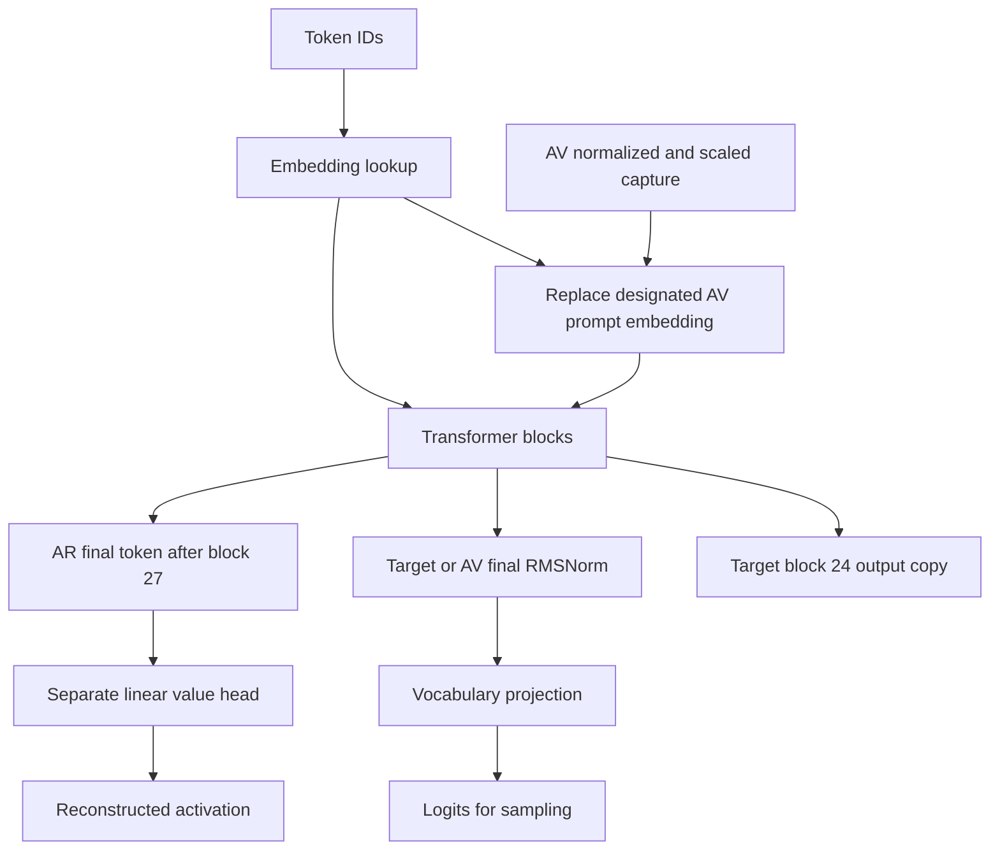
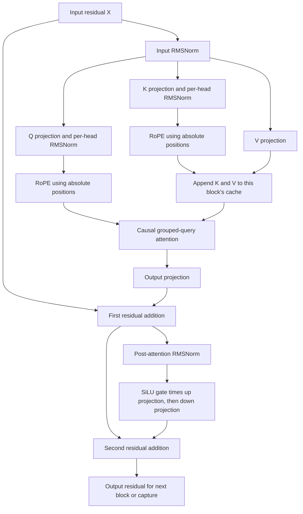

# Transformer execution algorithmic overlay

**Reviewed and accepted — 2026-10-17.** This expands the planned model computation used by
the [NLA experiment overlay](logical-overview.md). It defines mathematical
steps, observable boundaries, and state lifetimes before backend interfaces
or source files are chosen. Linux/NVIDIA comes first, Metal on macOS follows,
and AMD support remains undecided.

## Three uses of the transformer

| Role | Input path | Blocks and weights | Output path |
| --- | --- | --- | --- |
| Target | Prompt or generated token embeddings | 36 blocks, target weights | Final RMSNorm, vocabulary projection, next-token logits |
| Activation verbalizer | Trained prompt embeddings with one vector replacement, then generated token embeddings | 36 blocks, separate full AV weights | Final RMSNorm, vocabulary projection, description logits |
| Activation reconstructor | Description in the trained AR template | 28 blocks, separate AR weights | Last-token residual directly through the separate value head |

The target exposes a copy of its block-24 output while continuing through
the remaining blocks. The AV injection is at its input embedding sequence,
not at its block 24. The AR has no text-generation loop, final RMSNorm, or
vocabulary projection in the selected inference contract. Its 28-block depth
must not be inferred from the target's capture index.

These roles can share execution mechanisms without sharing weights, caches,
or assuming identical entry and exit paths. The
[pinned manifest](../../scripts/validation/models-8b.json) and
[reference comparison](../research/2026-10-16-nla-comparison/README.md)
establish the selected pairing.

## Model dimensions and notation

For the selected target and AV, residual width `D=4096`, block count `L=36`,
query heads `Hq=32`, KV heads `Hkv=8`, head width `d=128`, and MLP width
`F=12288`. Vocabulary size is 151936. The model uses full causal attention,
RMSNorm epsilon `1e-6`, unscaled RoPE with theta `1000000`, and untied input
and output embedding weights. These values come from the
[pinned Qwen3 configuration](https://huggingface.co/Qwen/Qwen3-8B/blob/b968826d9c46dd6066d109eabc6255188de91218/config.json).

Let `X_l` be the residual entering zero-based block `l`. `X_0` is the input
embedding sequence, and `X_(l+1)` is that block's output. A block-24 capture
is therefore `X_25[p]`. Use explicit block input/output names when translating
reference hooks; an API's hidden-state array index is not itself the contract.

The following is mathematical notation. Weight orientation and physical tensor
layout are implementation choices that must preserve these operations.

## Full model flow

### Checkpoint loading and binding

The setup path supplies an explicit artifact list with pinned sizes and hashes.
The format reader verifies those files, checks named tensor layouts and extents,
and owns immutable backing storage. Model configuration and shard-index bytes
belong to the same verified source identity. Acquisition remains separate from
loading; the reader does not discover extra weights or download replacements.

The selected model binder interprets configuration, maps tensor names to its
parameter slots, and validates every required shape and dtype. Missing or
unsupported parameters fail before device execution. The bound checkpoint owns
the archive and model description. Device residency belongs to a forward plan:
upload required weights once through bounded staging, and reuse them for that
plan's serial executions. Loading identity includes artifact hashes and the
model's binding convention. Keeping files unchanged while mapped is a caller
precondition; this design does not support concurrent mutation of weight files.

### Preparing the first execution recipe

The model emits a finite, ordered recipe of the supported operations with typed
tensor slots. Parameters and token IDs are external inputs; each intermediate
has one producer. Observation sites identify the tensor value at a semantic
boundary. The executor validates dependencies, resolves requested observations,
selects operation implementations and assigns storage. It does not reconstruct
Qwen3 equations from a model name. This is a linear schedule, with no graph
rewriting, autodifferentiation or arbitrary executable callbacks.

Operation preparation declares supported layouts/numerical modes, workspace
bytes and alignment before device allocation. The initial plan uses one ordered
queue and reuses scratch only after its last reader, including requested capture
copies. GPU copies at observation boundaries preserve values without a host
wait at each block. A completion point after final readback establishes host
readiness. Explicit waits report device failures; cleanup must not recycle
storage while work is pending. A later backend can change allocation and launch
mechanisms while consuming the same mathematical recipe.

### Model computation

The first slice separates pure preparation from execution. In-memory container
header parsing, Qwen3 configuration parsing, operation/recipe validation,
observation resolution and scratch placement do not open files or touch a GPU.
Unit tests can exercise their contracts directly. File verification, residency,
queue submission and full forward comparison belong to integration testing.
Pure numerical comparison accepts ordinary arrays and does not launch a model.

Scratch placement consumes checked resource lifetimes in the ordered schedule,
including capture-copy reads. A producer and its readers occupy inclusive step
intervals: two intervals sharing an endpoint cannot alias. Placement reports
aligned extents and arena size; exact offsets are an implementation choice.
Weights and retained outputs remain separate from reusable scratch. Admission
adds those allocations, maximum operation workspace and staging explicitly.

BF16 is a stored-bit format. Host conversion widens exactly to FP32 and narrows
with round-to-nearest, ties-to-even; raw capture copies perform no conversion.
Each CUDA operation states its FP32 intermediates and BF16 rounding boundaries.
These must be checked against the reference rather than assuming that equal
algebra implies equal reduced-precision execution. Initial projection uses
FP32 accumulation without silently enabling TF32. Initial attention streams
causal K/V tiles with an online softmax state and no full score matrix. Kernel
tile choices are private tuning choices, not contracts asserted by unit tests.

The direct embedding route serves target and AR inputs; the replacement route
serves AV prefill. Output branches are selected by model role, rather than
executed together. Capturing target block 24 is observational and does not
terminate its forward pass.

## One Qwen3 transformer block

The cache node describes incremental execution. A complete non-cached forward
pass, including the initial AR path, supplies the current sequence's K and V
directly instead of retaining them for later decoding.

The block follows the [Qwen3 reference implementation used by our probe](https://github.com/huggingface/transformers/blob/v4.57.3/src/transformers/models/qwen3/modeling_qwen3.py):

1. Normalize the incoming residual: `U = RMSNorm(X)`.
2. Project `Q = U Wq`, `K = U Wk`, and `V = U Wv`. Reshape into heads;
   normalize Q and K independently across each head's 128 features.
3. Rotate Q and K using RoPE at their sequence positions. V is not rotated.
4. Attend causally, sharing each KV head across four query heads.
5. Concatenate attention outputs and project them: `Y = X + Attention(Q,K,V) Wo`.
6. Normalize `Y`, then compute
   `X_next = Y + (SiLU(RMSNorm(Y) Wgate) * (RMSNorm(Y) Wup)) Wdown`.

Compute the second RMSNorm once and reuse its result. Attention and MLP
projections have no biases in this configuration. The target capture is the
second residual sum, before the next block's normalization.

### Attention and positional semantics

For query position `p` and query head `h`, use KV head `floor(h/4)` and keys
at positions `j <= p`. Weights are
`softmax_j(dot(Q[p,h], K[j,floor(h/4)]) / sqrt(128))`; the weighted sum of V
gives that head's output. Padding positions, if introduced by future batching,
must also be masked. The initial workload is one unpadded sequence.

RoPE uses the actual positions in the complete formatted sequence, including
control tokens. Chunk boundaries and backend cache offsets do not restart
those positions. Store rotated K and unrotated V in the logical KV cache.
The implementation may choose physical layouts and attention fusion without
materializing repeated KV heads or the full attention-score matrix.

## Prefill and decoding

**Prefill:** embed a prompt span and evaluate its positions with a causal mask.
Populate each block's cache for subsequent decoding. Capture all target
positions at the observation boundary, but vocabulary logits are needed only
for the last position when selecting the first continuation token. Chunked
prefill must let each chunk attend to the prior cache and the causal prefix
within the current chunk.

**Decode:** embed the single newly sampled token, using its absolute position.
At each block, append its K and V and attend to the cached prefix including
itself. After all blocks, normalize and project to logits for the next token.
Capture the consumed token's block-24 output before that buffer is reused.

The two paths compute the same causal function with different work shapes.
Prefill favors matrix operations over many tokens; decoding repeatedly reads
weights and an expanding cache for one token. They can use different kernels
while preserving the mathematical and capture contracts.

For final capture completion, consume the last emitted token without sampling
another. A future optimization may stop that pass after the capture boundary,
but only when no continuation or later-layer output is needed. The initial
correctness path may run the ordinary forward pass and discard its logits.

## NLA entry and exit paths

AV prefill starts from the exact trained prompt. Replace exactly one embedding
with `150 × h / ||h||_2`, computing the norm in FP32 and casting the injection
to the model's execution dtype. For this checkpoint, the injection token ID
is 149705 and its neighbors are 29 and 522. Check these values against the
checkpoint metadata and formatted token sequence; they are not generic NLA
constants. Subsequent AV decoding uses its own embeddings and cache normally.
These conventions are exercised in the
[8B reference probe](../../scripts/validation/compare_8b.py).

AR evaluates the formatted description causally through its 28 blocks. Take
the residual at the template's final token, after block 27, and apply the
separately loaded biasless `4096 × 4096` value head. Do not add a final
normalization, language-model head, or sampler. The initial AR operation is
one full forward pass without a persistent decoding cache. Validate its
tokenizer/template suffix before execution.

## State and observation boundaries

### Configurable observation points

The model implementation advertises supported observation sites with semantic
boundary, zero-based block index, vector width and numerical representation.
The first Qwen3 observation kinds are block input and block output. Block
output means the residual after that block's second residual addition.
Other intermediates require an explicitly advertised site before use.

The caller selects sites and token positions while preparing a forward run.
The executor validates them against the model's catalog, resolves positions,
computes checked output sizes, and plans copies before execution begins.
Changing the selected block does not require recompiling the engine. Requests
are fixed during that execution; this is not a callback interface that can
modify activations or invoke arbitrary user code inside a kernel.

The numerical harness may observe any advertised site. The selected NLA pair
independently requires block-24 output and validates that requirement against
the model catalog. Ability to capture another block does not establish NLA
support for interpreting it. No shared executor or observation contract uses
24 as a default, limit or special case.

Each result identifies its semantic site, consumed token positions, shape,
dtype and model execution identity. Retain original activation bits; any FP32
conversion for comparison or NLA normalization is a separate operation.
An empty request list creates no capture buffers or readbacks. Requested
copies complete before source reuse, and returned host bytes become readable
only after their completion. Compatible fusion must preserve requested sites.

### First forward pass

The first numerical slice evaluates a complete, unpadded multi-token sequence
with causal attention and no persistent KV cache. K and V are still computed
and used within the pass. Exact fixture token IDs isolate forward computation
from tokenizer verification. Return selected logits and requested observations;
do not sample a continuation or load the NLA during this check.

Verify block-input/output identity, alternate capture blocks, capture-on/off
outputs, prefix causality, and result lifetime independently of block 24.
Then cached generation can be compared against this full-sequence baseline.

### Storage lifetimes

| State | Lifetime and rule |
| --- | --- |
| Model weights | Immutable during a resident model phase; validate shape, dtype and provenance before dispatch |
| KV cache | Belongs to one model and one exact sequence prefix; never reused across target, AV, or AR weights |
| Residual and operation scratch | Reusable only after dependent operations and capture copies finish |
| Position information | Derived from the complete sequence; consistent across blocks and prefill/decode paths |
| Retained capture | Independent copy of raw target output; valid after scratch, cache and target weights are released |
| Logits | Produced for requested positions; sampling belongs to the generation flow outside the block |

An observation boundary is a required value, not necessarily a permanent GPU
buffer. Fused execution may expose or copy that value explicitly. If a kernel
cannot provide the correct block output, it cannot serve the capture path
without an alternative implementation. Readback completion must be explicit
before the host consumes a vector, including on a shared-memory backend.

## Backend variation to examine next

These are inputs to the later change-axis analysis, not module boundaries.

| What may vary | What must remain true |
| --- | --- |
| CUDA versus Metal dispatch, compilation and synchronization | Same model operation, sequence positions and defined completion dependencies |
| Tensor layout, tiling and kernel fusion | Same logical dimensions, causal visibility and observable residuals |
| BF16/FP16 storage and accumulation choices | Explicit numerical mode, tested errors, no silent precision substitution |
| Attention implementation and cache allocation strategy | Correct grouping, position addressing, masking and cache lifetime |
| Device allocation, staging and transfers | Memory admission is respected; consumers cannot read incomplete results |
| Future model architecture | Its own normalization, positional and input/output contracts are declared |

Changing a backend should not change the target capture location or AV prompt.
Changing a model can require new mathematics even on the same backend. Keep
those reasons to change distinct when deriving ownership later.

BF16 is the initial NVIDIA reference mode. Metal precision and hardware
requirements need validation when that backend is designed. Quantization is a
separate future change with additional capture and NLA comparisons. Cross-backend
bitwise equality is not assumed; small numerical differences can change a
sampled trajectory, so backend comparisons should first use fixed token inputs.

## Cost model

Let `B` be processed positions in a call and `S` the available context length.
Dense projections per block require approximately
`2 B [D(Hq*d + 2*Hkv*d) + (Hq*d)D + 3DF]` floating-point operations, counting
a multiply-add as two. Attention adds work proportional to `B*Hq*S*d`, with
prefill's causal triangle reducing the number of valid query/key pairs.
Normalization, rotations and nonlinearities add elementwise work.

For `N` retained positions, logical KV storage is
`2*L*N*Hkv*d*element_bytes`. Target/AV BF16 caches add 144 KiB per position;
raw target captures add 8 KiB per position at one layer. Prefill scratch depends
on chunking and fusion; the overlay does not require an `N × N` score buffer.
Vocabulary projection adds approximately `2*B_logits*D*vocabulary_size`
operations, where `B_logits` counts only positions whose logits are requested.

Count weight reads, cache reads/writes, scratch traffic, capture copies,
allocations, dispatches and synchronization separately. Derive peak memory
from simultaneously live allocations. Shared memory on Metal changes transfer
mechanics, but does not remove bandwidth costs or ordering requirements.

## Verification boundaries

Before optimizing across boundaries, compare fixed-input embeddings, Q/K
normalization and positional transforms, attention outputs, block residuals,
final logits, AV injected embeddings and AR reconstructed vectors against the
pinned reference. Intermediate comparisons help locate an error; matching
generated prose does not prove these operations match.

Compare full causal evaluation, chunked prefill, and cached decode on the same
token sequence. Include multi-position prefixes, position zero, chunk edges,
longer cache offsets, and target block 24. Verify capture-on versus capture-off
execution and capture validity after model release. Derive numerical tolerances
for each precision/path from reference evidence before accepting implementation.

Measure the NVIDIA path on the 3090 Ti and exercise retained PTX with
`CUDA_FORCE_PTX_JIT=1`. Build success alone cannot establish numerical or
performance behavior on NVIDIA or Metal. The next design step assigns the
independent reasons for change; only then do interfaces and files follow.
